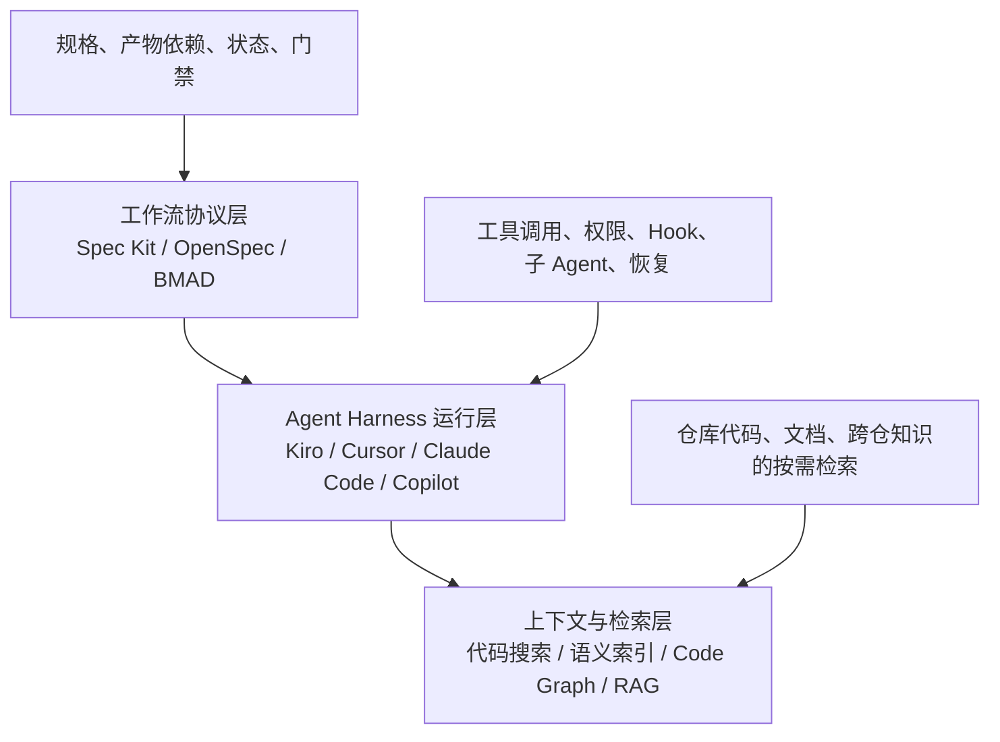
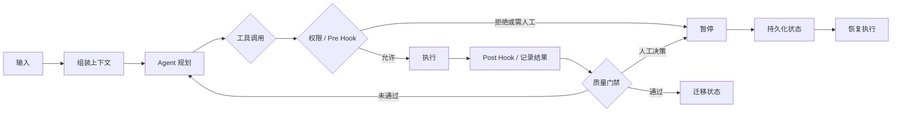
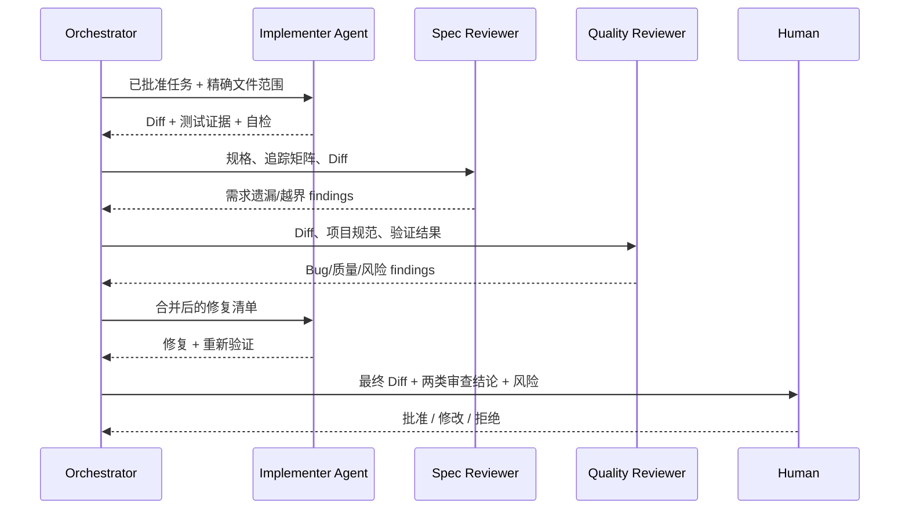
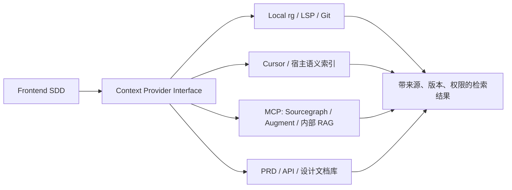
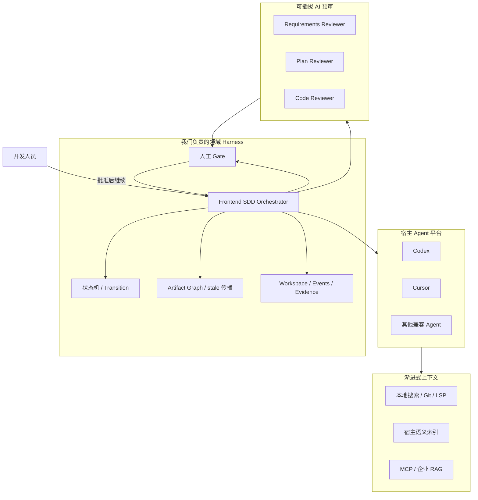

# 前端 AI 研发工作流竞品能力调研

> 调研时间：2026-09-12
> 调研目标：识别同类 SDD / Agent 工作流在 Harness、子 Agent 审查、代码上下文与 RAG 等方面的成熟能力，并判断哪些能力值得纳入当前 Frontend SDD。
> 当前方案范围：公司前端存量项目中的 PRD / 接口文档 → 需求分析 → 技术方案 → 代码 → 验证。

## 1. 结论先行

当前市场上的“AI 开发工作流”实际由三层组成，而不是一个单独的 Skill 或一组 Markdown 模板：

对当前 Frontend SDD 最重要的判断是：

1. **我们已经具备工作流协议的雏形，但还不是完整 Harness。** `status.json`、artifact graph、人工 Gate 和 Workspace 已经解决“当前做到哪里、哪些产物过期、依据是什么”；仍缺统一迁移命令、事件日志、失败恢复和确定性 Hook。
2. **子 Agent 最适合先替代重复检查，不适合直接替代人工授权。** 可以让独立 Reviewer 检查需求覆盖、方案与仓库一致性、代码质量，再把结果交给人；但产品范围、接口歧义、页面体验和最终交付责任仍应由人确认。
3. **RAG 应先复用 Codex / Cursor 的项目检索能力，不急于自建向量库。** 小到中型单仓库通常先用文件搜索、符号搜索、语义索引即可；只有出现跨仓库、大型 Monorepo、历史设计文档检索不准等可量化问题时，再接入 Sourcegraph、Augment 或公司知识库。
4. **最值得学习的不是某个竞品的整套流程，而是四项基础设施：** 可恢复 Harness、职责隔离的 Reviewer、确定性质量门禁、可度量的上下文检索。

## 2. 先把几个概念分清

| 概念 | 本质 | 决定什么 | 不负责什么 |
| --- | --- | --- | --- |
| SDD 工作流 | 从需求到实现的产物与决策协议 | 要生成什么、按什么顺序、何时审核 | 不直接提供模型、终端和代码索引 |
| Skill / Rule | 可复用的 Agent 行为说明 | Agent 在特定场景应该怎样做 | 不保证状态持久化、重试和事务一致性 |
| Agent Harness | Agent 的运行与编排底座 | 上下文组装、工具调用、权限、状态、Hook、子 Agent | 不自动拥有正确的业务规格 |
| 子 Agent | 独立上下文中的专职执行者 | 并行探索、实现、审查、验证 | 不能天然保证结论正确或拥有审批责任 |
| RAG / Context Engine | 从外部知识中检索相关片段并注入上下文 | Agent 此刻能看到哪些代码和文档证据 | 不等于长期记忆，也不等于工作流状态 |
| Workspace | 一次需求的持久产物与审计目录 | 已确认什么、改了什么、如何验证、哪些内容过期 | 不是代码副本，也不是语义检索引擎 |

一个成熟方案通常是“工作流协议 + Harness + Context Engine”的组合。只复制命令或 Skill，无法得到竞品完整体验。

## 3. 代表性方案及其核心能力

### 3.1 工作流 / 方法层

| 方案 | 核心定位 | 有代表性的能力 | 对我们的启发 |
| --- | --- | --- | --- |
| GitHub Spec Kit | 通用、跨 Agent 的 SDD 工具与工作流 | YAML 工作流、命令步骤、条件分支、人工 Gate、运行状态持久化、失败/暂停后 Resume、Overlay 扩展 | 将当前隐式的阶段执行升级为显式、可校验、可恢复的 Harness |
| OpenSpec | 轻量 Change 与规格协议 | proposal/spec/design/tasks 依赖图、Delta Spec、apply、archive、自定义 Schema | “产物依赖图”不只用于提示 stale，还可以驱动下一步允许生成什么 |
| BMAD Method | 多角色、全生命周期开发方法 | Analysis/Planning/Solutioning/Implementation，多角色 Agent，Quick Flow，Correct Course，Code Review，项目上下文文档 | 按需求复杂度选择流程，不必让所有需求都跑同样重的链路 |
| Superpowers | Agent 软件工程方法和 Skills 集合 | 任务级新鲜子 Agent、规格符合性审查、代码质量审查、最终分支审查、TDD、Worktree | Reviewer 与 Implementer 分离，避免同一个上下文“自己写、自己证明正确” |

Spec Kit 的工作流会在每一步后保存 `state.json`、输入和执行日志，并可从暂停或失败的准确步骤恢复；Gate 可以明确 approve/reject/retry。它是目前最接近“可恢复工作流 Harness”的开源参考。[Spec Kit Workflows](https://github.com/github/spec-kit/blob/main/docs/reference/workflows.md)

OpenSpec 用 Schema 声明产物及依赖关系，例如 tasks 依赖 specs 与 design；Change 完成后把 Delta Spec 合并到主规格并归档，适合持续演进的存量项目。[OpenSpec Concepts](https://github.com/Fission-AI/OpenSpec/blob/main/docs/concepts.md)

BMAD 强调逐阶段建立上下文，也提供面向小需求的 Quick Flow 和面向变更的 Correct Course，而不是让所有需求都走完整重流程。[BMAD Workflow Map](https://github.com/bmad-code-org/BMAD-METHOD/blob/main/docs/reference/workflow-map.md)

Superpowers 的子 Agent 流程为每个任务分配独立 Implementer，再分别做规格符合性与代码质量审查，最后做全分支审查。[Subagent-Driven Development](https://github.com/obra/superpowers/blob/main/skills/subagent-driven-development/SKILL.md)

### 3.2 Harness / Agent 平台层

| 平台 | Harness 能力 | 子 Agent / 自动审查 | 上下文能力 | 典型边界 |
| --- | --- | --- | --- | --- |
| Kiro | Specs、Steering、Hooks、权限、Checkpoint、Compaction、MCP，共用统一 Harness | Custom Agents、Sub-agents、并行任务；Hook 可做事件自动化 | `.kiro/` 项目上下文、按 always/fileMatch/auto/manual 注入 | 平台绑定较强；团队要采用其 IDE/CLI/Web 运行时 |
| Cursor | 本地 Agent、Cloud Agent、后台任务、规则、MCP | 独立上下文子 Agent，可前台/后台/并行；可定义 reviewer | 项目索引、语义搜索、文件与符号检索 | Cloud Agent 环境可能与开发者本机不同；并行会增加成本 |
| Claude Code | Hooks、权限、Skills、MCP、Worktree、会话与上下文管理 | Subagents、Agent Teams、Agent Hook；可在完成时强制审查 | 本地搜索、按需上下文、MCP 外部知识 | Agent Teams 仍属实验能力；并行会成倍增加 Token |
| GitHub Copilot | CLI/Cloud Agent、仓库集成、Hook、MCP、临时执行环境 | Custom Agent、临时 Subagent、Copilot Code Review | 仓库与 PR 上下文、项目指令 | 更偏 GitHub Issue/PR 交付链，与本地页面联调链路不同 |
| Augment / Sourcegraph | 主要不是 SDD Harness，而是可被 Agent 调用的上下文基础设施 | 不以工作流审查为核心 | 跨仓语义搜索、关键字搜索、Code Graph、权限过滤 | 引入额外服务、索引、权限和成本治理 |

Kiro 对 Harness 的定义最完整：同一运行时负责上下文组装、模型循环、工具权限、Hook、MCP、子 Agent 和压缩；项目级 `.kiro/` 配置随仓库共享。[Kiro Harness](https://kiro.dev/docs/how-kiro-works/)

Cursor 子 Agent 拥有独立上下文，可自动或显式调用，也能定义 `code-reviewer` 等角色；官方同时建议先从少量聚焦的子 Agent 开始，因为角色过多会增加维护和执行成本。[Cursor Subagents](https://prod.cursor.com/docs/subagents)

Claude Code 支持子 Agent、后台会话、Agent Teams 和 Worktree 等不同并行方式，并明确说明并行会增加 Token 使用；Hook 还能在工具调用、子 Agent 完成或任务完成时进行阻断、审计或注入上下文。[Claude Code Agents](https://code.claude.com/docs/en/agents)、[Claude Code Hooks](https://code.claude.com/docs/en/hooks-guide)

GitHub Copilot 已把 Cloud Agent、Custom Agent、代码审查和 Hook 组合进 GitHub 交付链；Custom Agent 由独立上下文的临时子 Agent 执行。[GitHub Custom Agents](https://docs.github.com/en/copilot/how-tos/copilot-cli/customize-copilot/create-custom-agents-for-cli)、[GitHub Agent 能力说明](https://github.com/github/docs/blob/main/content/copilot/responsible-use/agents.md)

## 4. Harness：竞品真正补齐了什么

Harness 不是“一个总 Skill”，而是把 Agent 的非确定性推理包在一个可预测的执行外壳里。

| Harness 能力 | 竞品做法 | 当前方案 | 建议 |
| --- | --- | --- | --- |
| 显式步骤 | YAML/命令/Spec Task | 由 Skill 根据 `state` 推理 | 增加统一 `transition` / `run-stage` 命令 |
| 状态持久化 | 每步保存运行状态、输入和日志 | `status.json` + revisions | 保留现有模型，补事件日志和执行 ID |
| Pause / Resume | Gate 或失败后从断点恢复 | 会话重启后由 Agent读取状态继续 | 增加 `previousState/resumeState` 和失败原因 |
| 条件与重试 | if/switch/retry/on_reject | 主要写在 Skill 规则中 | 只为确定性流程引入，不构建通用 DSL |
| 权限 | 工具级 allow/ask/deny | 依赖 Codex/Cursor 平台权限 | 工作流声明风险等级，执行仍交给平台权限系统 |
| Hook | 工具前后、停止、任务完成事件 | 暂无跨平台确定性 Hook | 先用 CLI 校验命令；按平台生成轻量适配器 |
| 可观测性 | step log、状态、后台任务面板 | Workspace 有结果，无完整运行轨迹 | 增加 `events.jsonl`，记录阶段、命令、Reviewer 结论 |

**判断：** 当前不应自研一个替代 Codex/Cursor 的通用 Harness；应该实现一个“小型领域 Harness”，只管理 Frontend SDD 的阶段、产物、Gate、恢复与审计，把代码搜索、命令执行和权限继续交给宿主平台。

## 5. 子 Agent 能否代替人工审查

### 5.1 最适合自动化的审查

| Reviewer | 输入 | 检查内容 | 输出 | 是否可自动通过 |
| --- | --- | --- | --- | --- |
| Evidence Reviewer | PRD、接口文档、证据表 | 引用是否真实、事实/推断是否混淆、是否漏掉冲突 | findings + 证据位置 | 可通过机器 Gate，但不能确认业务歧义 |
| Scope Reviewer | scope、仓库边界 | 是否越过前端职责、是否遗漏入口与场景 | scope findings | 低风险且无歧义时可建议通过 |
| Spec Reviewer | frontend-spec、acceptance | 验收是否可观察、空态/失败态/边界是否覆盖 | spec findings | 只能预审，产品语义仍由人确认 |
| Plan Reviewer | plan、真实仓库 | 文件与符号是否存在、方案是否符合现有模式、改动是否过度 | plan findings | 可自动阻断明显错误 |
| Code Reviewer | Diff、规格、计划 | 需求覆盖、Bug、可维护性、安全和回归风险 | 分级 findings | 可作为合并前预审，不能成为唯一责任人 |
| Verification Reviewer | 命令输出、页面证据 | 测试是否覆盖批准需求、失败是否被隐藏 | verification findings | 自动化测试可硬阻断；视觉/交互仍需人验收 |

推荐的审查链不是“AI 写完后再问同一个 AI 是否正确”，而是上下文和职责隔离：

### 5.2 为什么不建议现阶段移除人工 Gate

- Reviewer 与 Implementer 可能共享同一模型偏差；“两个 Agent 同意”不等于独立事实成立。
- PRD 歧义、交互体验和业务取舍没有可执行真值，AI 只能给建议。
- 自动测试只能证明已编码的断言，不能证明遗漏的需求。
- Agent 可能把仓库既有实现误认为正确规范。
- 最终提交、发布和责任归属仍属于组织治理，而不是模型置信度。

所以，子 Agent 的目标应定义为：**把人工审查从“从头查找所有问题”变成“确认 AI 已归纳的证据、风险和少量决策点”。**

## 6. RAG 与代码上下文：需要什么，不需要什么

### 6.1 代码 RAG 不只是向量搜索

成熟代码上下文通常组合多种检索：

| 检索方式 | 擅长 | 典型不足 |
| --- | --- | --- |
| 文件/关键字搜索 | 精确变量、接口名、错误码 | 不理解同义表达和意图 |
| 语义向量搜索 | 用自然语言找相似实现 | 可能召回“看起来像但实际无关”的代码 |
| 符号与引用关系 | 找定义、调用链和影响范围 | 依赖语言服务与索引质量 |
| Code Graph | 跨文件、跨模块、跨仓依赖 | 建设和维护成本更高 |
| 文档/工单检索 | 找历史决策、PRD、接口和规范 | 权限、版本、过期内容治理复杂 |
| Agent 主动探索 | 动态组合 `rg`、Git、测试与阅读 | 消耗上下文和时间，结果不稳定 |

Cursor 会为代码库建立语义索引；Sourcegraph Cody 组合关键字搜索、Sourcegraph Search 和 Code Graph；Augment 的 Context Services 可通过 MCP/SDK把跨仓语义检索提供给不同 Agent。[Cursor Indexing](https://www.cursor.com/security)、[Sourcegraph Cody Context](https://sourcegraph.com/docs/cody/core-concepts/context)、[Augment Context Services](https://docs.augmentcode.com/context-services/overview)

### 6.2 当前方案的渐进路线

| 阶段 | 适用条件 | 方案 |
| --- | --- | --- |
| L0：宿主原生检索 | 当前试点、小中型单仓库 | Codex/Cursor 文件搜索、符号搜索、语义索引；Workspace 提供明确入口 |
| L1：结构化项目上下文 | 重复出现项目约定遗漏 | 自动生成并维护 `project-context.md`，只保存稳定事实和命令 |
| L2：文档索引适配器 | PRD/API/设计文档数量明显增加 | 为 Workspace 和公司文档提供 MCP 搜索，返回来源、版本和段落 |
| L3：跨仓 Context Engine | 前端需频繁理解多个组件库/BFF/协议仓 | 接入 Sourcegraph/Augment/内部检索，加入权限过滤和增量索引 |
| L4：反馈闭环 | 已有足够真实任务样本 | 根据召回命中率、遗漏率、Token 与耗时调整检索策略 |

不建议一开始就自建向量数据库。先记录以下指标，确认问题真实存在：

- Agent 首次找到正确入口文件的比例。
- 因遗漏相关文件导致的返工次数。
- 每阶段用于探索仓库的耗时与 Token。
- 检索结果中错误版本、无权限或过期文档的比例。
- 跨仓需求占所有需求的比例。

## 7. 能力总表

图例：`●` 核心能力，`◐` 可实现或依赖宿主，`—` 非核心定位。

| 能力 | Spec Kit | OpenSpec | BMAD | Superpowers | Kiro | Cursor | Claude Code | GitHub Copilot | 当前 Frontend SDD |
| --- | :---: | :---: | :---: | :---: | :---: | :---: | :---: | :---: | :---: |
| 规格→计划→任务→实现 | ● | ● | ● | ● | ● | ◐ | ◐ | ◐ | ● |
| 产物依赖图 | ◐ | ● | ◐ | ◐ | ◐ | — | — | — | ● |
| 显式状态持久化 | ● | ◐ | ● | ◐ | ● | ● | ● | ● | ● |
| 暂停/恢复/重试 | ● | ◐ | ◐ | ◐ | ● | ● | ● | ● | ◐ |
| 人工 Gate | ● | ◐ | ● | ● | ● | ◐ | ◐ | PR Review | ● |
| 子 Agent 编排 | 依赖宿主 | 依赖宿主 | ● | ● | ● | ● | ● | ● | — |
| 独立 Reviewer | 依赖工作流 | 依赖宿主 | ● | ● | ◐ | ● | ● | ● | — |
| 确定性 Hook / Policy | ◐ | — | ◐ | ◐ | ● | ◐ | ● | ● | 校验脚本 |
| 代码语义索引 / RAG | 依赖宿主 | 依赖宿主 | 依赖宿主 | 依赖宿主 | ◐ | ● | 可接 MCP | ◐ | 依赖宿主 |
| 跨仓上下文 | 依赖宿主 | — | ◐ | — | MCP | Cloud/MCP | MCP | MCP | — |
| 需求变化后产物失效 | ◐ | ● | Correct Course | 回改计划 | ◐ | — | — | — | ● |
| 需求级审计 Workspace | ● | ● | ● | 计划/分支 | ● | 会话/分支 | 会话/任务 | Issue/PR | ● |
| 真实本地项目直接执行 | ● | ● | ● | 可选 Worktree | IDE/CLI | ● | ● | CLI | ● |

这张表不能简单按 `●` 数量排名：前四项偏工作流协议，后四个平台偏运行时能力。当前方案应该与宿主平台组合，而不是重复实现宿主已经提供的能力。

## 8. 对当前 Frontend SDD 的建议路线

### P0：先把现有工作流变成可靠的轻量 Harness

| 能力 | 最小落地 |
| --- | --- |
| 显式迁移 | 增加 `transition` 命令，校验 from/to、产物、stale 和人工批准 |
| 阻断恢复 | 为 `BLOCKED` 保存 `previousState`、`resumeState`、reason、requiredAction |
| 事件审计 | 增加 `events.jsonl`，记录 run/stage/transition/command/reviewer/gate |
| 稳定入口 | Codex Skill + Cursor Command/Rule 使用同一个工作流定义和 CLI |
| 机器 Gate | lint/test/build、必需产物、追踪完整度由脚本硬校验 |

### P1：引入三个 Reviewer 子 Agent，但保留人工批准

首批只做三个，避免角色泛滥：

1. `requirements-reviewer`：审查证据、范围和规格覆盖。
2. `plan-reviewer`：审查技术方案是否真实映射仓库、是否过度设计。
3. `code-reviewer`：同时读取批准规格、任务、Diff 和验证结果，输出分级 findings。

执行原则：Reviewer 默认只读；不能修改批准记录；发现问题后由 Orchestrator 汇总，再交给单个 Implementer 修复；最终 Gate 仍由开发者确认。

### P1：补结构化项目上下文，不急于自建 RAG

- 生成 `project-context.md`：技术栈、目录约定、运行命令、测试策略、关键公共组件。
- 每项事实必须带来源文件和最后验证时间。
- 稳定事实才常驻；业务细节仍由 Agent 按需检索。
- 继续优先使用 Codex/Cursor 原生搜索，收集检索失败数据。

### P2：有数据后再接 Context Provider

只有跨仓和知识检索成为主要瓶颈时，增加统一 `context-provider` 接口：

接口层避免把工作流绑定到某一家 RAG 产品，也便于公司未来接内部知识库。

### P2：建立真实任务评测集

从已完成需求中脱敏选取 10～20 个样本，记录：

- 需求点覆盖率、错误推断数、职责越界数。
- 第一轮方案通过率、人工修改次数。
- Reviewer 发现的有效问题与误报。
- 代码返工次数、验证通过率。
- 总耗时、Agent 耗时、人工审核耗时、Token 成本。

没有这些指标，就无法判断子 Agent 和 RAG 是提高质量，还是只增加调用次数和“看起来更完整”的文档。

## 9. 不建议现在做的能力

| 暂缓项 | 原因 |
| --- | --- |
| 完全移除人工审核 | 业务语义、交互体验和最终责任无法由模型自证 |
| 每个阶段都启用多个子 Agent | Token、耗时和结论合并成本会快速增加 |
| 自研通用 Agent Harness | Codex/Cursor/Claude/Kiro 已覆盖模型、工具、权限和上下文循环 |
| 默认强制 Cloud Agent / Worktree | 与当前“开发者真实本地项目直接验收”目标冲突 |
| 一开始建设全量向量库 | 尚未证明原生检索是主要瓶颈，且会引入权限与新鲜度问题 |
| 把全部项目资料常驻上下文 | 增加 Token 和干扰，应按稳定性与相关性渐进加载 |

## 10. 最终建议架构

这条路线保持了当前 SDD 的核心：证据、范围、规格、计划、状态一致性、人工决策和需求级留痕；同时吸收竞品成熟能力，但不把工作流仓库扩张成另一个 IDE、另一个 Git 平台或另一个向量数据库。

## 11. 官方参考资料

- [GitHub Spec Kit：Workflows](https://github.com/github/spec-kit/blob/main/docs/reference/workflows.md)
- [OpenSpec：Concepts](https://github.com/Fission-AI/OpenSpec/blob/main/docs/concepts.md)
- [OpenSpec：CLI](https://github.com/Fission-AI/OpenSpec/blob/main/docs/cli.md)
- [BMAD Method：Workflow Map](https://github.com/bmad-code-org/BMAD-METHOD/blob/main/docs/reference/workflow-map.md)
- [Superpowers：Subagent-Driven Development](https://github.com/obra/superpowers/blob/main/skills/subagent-driven-development/SKILL.md)
- [Kiro：How Kiro Works](https://kiro.dev/docs/how-kiro-works/)
- [Kiro：Specs](https://kiro.dev/docs/specs/)
- [Cursor：Subagents](https://prod.cursor.com/docs/subagents)
- [Cursor：Background Agents](https://docs.cursor.com/background-agent)
- [Claude Code：Agents](https://code.claude.com/docs/en/agents)
- [Claude Code：Hooks](https://code.claude.com/docs/en/hooks-guide)
- [GitHub Copilot：Custom Agents](https://docs.github.com/en/copilot/how-tos/copilot-cli/customize-copilot/create-custom-agents-for-cli)
- [Sourcegraph：Cody Context](https://sourcegraph.com/docs/cody/core-concepts/context)
- [Augment：Context Services](https://docs.augmentcode.com/context-services/overview)
