# Frontend SDD 工作流设计说明

> 版本基线：`feat/sdd-workflow-v0.2`（`66ea97a`）
> 面向对象：前端开发、技术负责人、研发管理者
> 核心范围：现有前端仓库中的 PRD / 接口文档 → 技术方案 → 代码 → 验证，不覆盖后端、数据库、自动合并和发布。

## 0. 一句话说明

这套工作流不是让 AI “拿到 PRD 后一次性把代码写完”，而是把 **PRD 到代码之间原本依赖开发者个人经验的隐性过程，变成有证据、有状态、有人工审核、有变更传播、有最终留痕的前端交付链**。

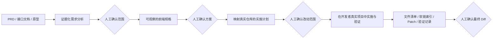

## 1. 为什么要做这套工作流

### 1.1 真正的问题不只是“AI 会不会写代码”

现在的 Coding Agent 已经能完成检索、修改和运行代码。真正影响 PRD → Code 稳定性的，是前置判断与过程控制：

- PRD 描述的是业务意图，不是完整的前端实现契约。
- PRD、接口文档、原型和现有代码之间可能不一致。
- 前端需求经常混有后端数据处理、数据库或其他仓库职责。
- AI 很容易把“合理推断”误当成“已确认需求”。
- 技术方案如果没有映射到真实仓库，只会成为一份看起来正确的通用文档。
- 需求在中途修改后，旧方案、旧任务和旧验证结果可能继续被误用。
- 一次性生成大量代码，会把错误发现时间推迟到最终 Review。
- 最终 Diff 很难回答“这行代码来自哪条需求、如何验证”。

### 1.2 这套设计解决什么

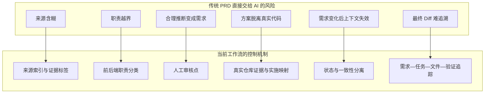

最终目标不是追求“零人工”，而是让人的注意力集中在几个高价值决策点：范围是否正确、方案是否符合项目、改动是否可以交付。

## 2. 为什么选择当前方案

### 2.1 SDD 是主线，TDD 是实施阶段的重要手段

| 方案 | 主要回答的问题 | 优势 | 单独作为 PRD → Code 主线的不足 | 在当前方案中的位置 |
| --- | --- | --- | --- | --- |
| PRD 一次性生成代码 | 能否快速产出代码 | 演示快、前期成本低 | 需求歧义、职责边界和错误假设会直接进入代码 | 不采用为主线，只允许在已批准任务内执行 |
| TDD | 代码行为是否满足测试 | 反馈快、利于回归和设计 | 测试本身仍需要正确规格；无法判断 PRD 是否完整、前后端职责是否正确 | IMPLEMENTING / VERIFYING 阶段使用 |
| 纯文档模板 | 是否有统一文档格式 | 简单、容易开始 | 文档之间缺少状态、依赖和失效机制，容易形式化 | 保留模板，但增加状态机和一致性图 |
| 强制 Worktree + 额外 PR | 如何隔离代码变化 | 隔离性强、便于并行 | 可能与开发者本地配置和运行环境不一致；额外 PR 与现有 Review 重复 | 不作为默认路径，需要时由开发者自行选择 |
| 当前 Frontend SDD | 是否在正确范围内，用可验证方式交付正确改动 | 证据、审核、追踪、一致性和真实环境兼顾 | 比一次性生成多出前置分析与审核成本 | 当前主线 |

SDD 与 TDD 并不冲突：

- SDD 更偏向保证 **做的是正确的需求**。
- TDD、自动化测试和页面验收更偏向保证 **代码正确实现了规格**。
- 当前工作流以 SDD 管理全链路，在实施和验证阶段使用项目已有的测试能力。

### 2.2 与其他开源工作流的横向对比

本方案不是从零发明“规格驱动开发”。调研中重点参考了三个具有代表性的开源方向：

- [GitHub Spec Kit](https://github.com/github/spec-kit)：通用、可扩展的 SDD 工具集，核心链路是 Specify → Plan → Tasks → Implement，并提供多种 Agent 集成、扩展、Preset 和自动化 Workflow。
- [OpenSpec](https://github.com/Fission-AI/OpenSpec)：强调轻量的“人和 AI 先达成协议再编码”，以 change 目录集中保存 proposal、spec、design、tasks，并通过 propose、apply、sync、archive 管理变化。
- [BMAD Method](https://github.com/bmad-code-org/BMAD-METHOD)：覆盖分析、规划、方案、实施等更完整的软件生命周期，通过不同角色 Agent 和不同复杂度 Track 组织工作。

| 对比维度 | GitHub Spec Kit | OpenSpec | BMAD Method | 当前 Frontend SDD |
| --- | --- | --- | --- | --- |
| 核心定位 | 可扩展、跨 Agent 的通用 SDD Harness | 轻量的规格协议与 Change 管理 | 多角色、全生命周期的敏捷 AI 方法 | 公司前端存量项目的 PRD → Code 受控交付 |
| 典型主线 | Constitution → Specify → Plan → Tasks → Implement / Converge | Propose → Apply → Sync → Archive | Analysis → Planning → Solutioning → Implementation | Evidence → Scope → Spec → Plan → Implement → Verify → Final Review |
| 输入假设 | 通用的功能描述，可用于新建和存量项目 | 从变更描述形成 proposal 和 delta spec | 可以从想法、PRD、架构和 Story 逐步展开 | 公司已有 PRD、接口文档、原型与真实前端仓库 |
| 产物组织 | feature spec、plan、tasks 等持久产物 | 每个 change 自包含 proposal、spec、design、tasks | 按阶段、角色和 Story 生成上下文 | 每个需求拥有 analysis、design、coding-changes、verification、revisions |
| 需求变化 | 强调规格持续演进和 brownfield 工作流 | 直接编辑 live artifacts，再 continue / apply；完成后合并 delta spec 并 archive | 使用 correct-course 等流程调整计划 | 显式计算下游 stale、使受影响批准失效、在当前阶段同步 |
| 状态与门禁 | 可通过 Workflow 持久化步骤、暂停和人工 Gate | artifact dependency 和 status 决定下一产物；命令分阶段执行 | 阶段、Story 状态、Review 和不同 Track 共同控制 | 单一阶段状态 + 独立 consistency + 四个人工审核点 |
| 项目环境 | 支持多 Agent、通用项目和可组合扩展 | 支持多种编码工具，强调使用现有工具 | 支持多 IDE、不同规模和多角色 | AI 与开发者直接使用当前真实前端项目，不强制 Worktree |
| 团队扩展 | Extensions、Presets、Workflows、Bundles，能力完整 | Schema、模板、配置和自定义工作流 | Module、Agent、Workflow 和 Track | 统一仓库分发多个 Skills，暂不增加复杂路由 |
| 上手体验 | 能力全面，相应概念和命令较多 | 核心路径短，命令体验成熟 | 引导充分，但流程和角色最丰富 | 目标是“给文档 → 自动走当前阶段 → 在关键点审核” |
| 最适合 | 需要通用平台、跨团队集成和高度扩展的组织 | 希望用较轻规格层管理持续变更的团队 | 从产品规划到交付都希望由多角色 Agent 协作的团队 | 已有研发流程、主要缺少前端 PRD 到代码控制链的小组 |

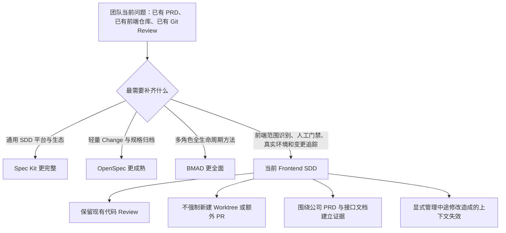

#### 我们学习了什么

- 从通用 SDD 工具学习“规格、计划、任务、实现”的逐层收敛，而不是一次性生成。
- 从 Change Folder 思路学习“一个需求一个目录、产物集中、完成后仍可审计”。
- 从多阶段与多角色方法学习“复杂任务需要分工和上下文隔离”，但当前不提前引入完整角色体系。
- 从可扩展生态学习团队能力应该统一分发，而不是由每个人手工维护。

#### 为什么没有直接照搬

这三个项目都面向更广的项目类型和使用场景。我们的首要目标更窄：让前端开发人员在现有 Vue / React 项目里，把公司的 PRD 和接口文档可靠地转成可审核代码。

直接引入通用方案并非不可行，但团队仍需二次解决：

- 如何区分公司 PRD 中的前端行为、后端数据和跨仓库职责。
- 如何保证 AI 不把推断扩展为需求。
- 如何让开发者在当前本地环境审核页面，而不是切换到另一个执行环境。
- 如何记录需求开始前已有的未提交改动，避免归因错误。
- 如何在中途修改规格时显式发现所有过期的下游产物和批准。

因此当前选择是“吸收成熟方案的核心思想，保留一个更窄、更贴近前端存量需求的执行层”。它不是通用能力最强的方案，而是当前试点成本和实际开发摩擦更低的方案。

### 2.3 设计方案的实际演变

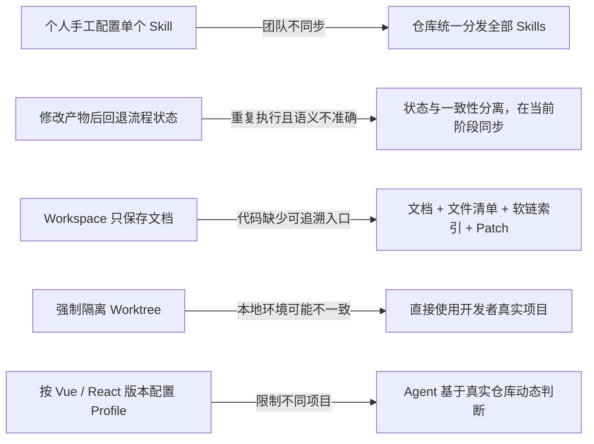

这些变化背后的共同判断是：**工作流应该约束证据、决策和交付边界，不应重复限制 Agent 已经能够从仓库中判断的技术事实。**

### 2.4 关键取舍

1. **不追求一步到位。** 需求错误越早暴露，修正成本越低。
2. **不强制隔离开发环境。** 开发者和 AI 应在同一个真实项目里看到相同依赖、配置和页面效果。
3. **不把 Workspace 变成第二份源码。** 业务源码只有一份；Workspace 记录过程与结果。
4. **不硬编码框架版本。** Vue 3、Vue 2、React、Node 和包管理器均由 Agent 根据仓库证据判断。
5. **不让每个人自行拼装 Skills。** 团队仓库统一分发，具体 Skill 仍依靠名称、描述和 Agent 渐进式触发。
6. **不让状态回退代替一致性管理。** 当前工作阶段和产物新鲜度是两个不同维度。

## 3. 总体架构

工作流分为三个相互配合、职责不同的平面。

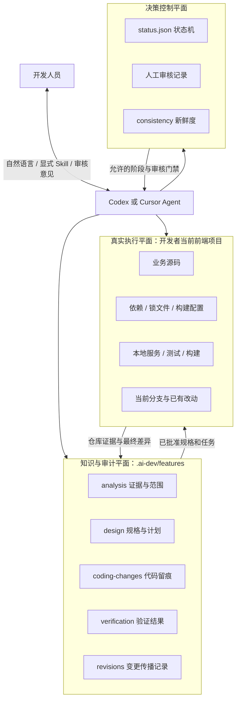

### 三个平面的职责

- **决策控制平面**：决定当前能做什么、哪些内容已被批准、哪些产物已经过期。
- **知识与审计平面**：保存需求理解、设计、任务、变更和验证证据。
- **真实执行平面**：唯一的业务代码来源，也是开发者实际启动和验收页面的环境。

## 4. 开发人员的完整使用流程

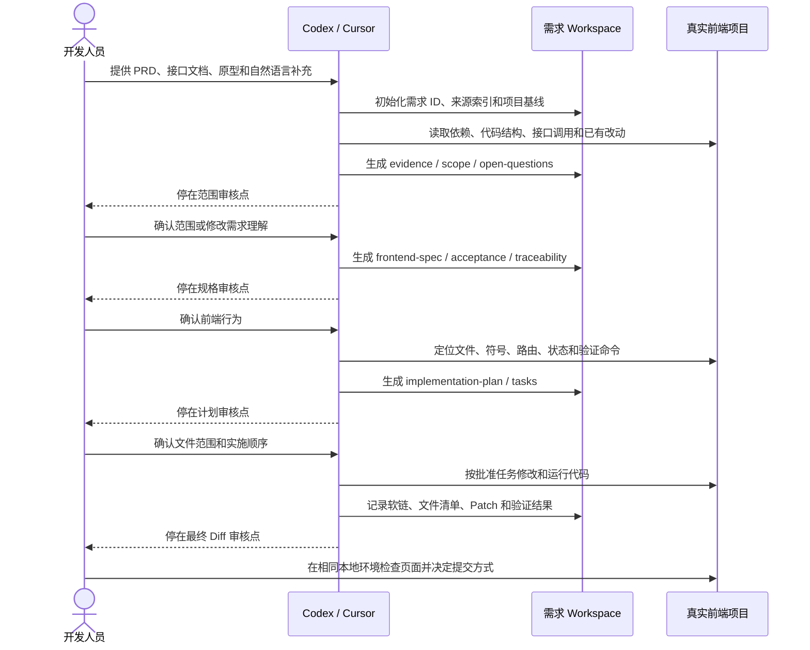


## 5. 每个阶段的意义与中间产物

| 阶段 | 这一阶段解决的问题 | Agent 的主要动作 | 中间产物 | 人工关注点 |
| --- | --- | --- | --- | --- |
| `INGEST` | 输入是否完整、来源是否可信、目标项目是否正确 | 登记来源；读取 PRD、接口和原型；检查真实仓库；区分事实与推断 | `source-index.md`、`evidence.md`、`scope.md`、`open-questions.md` | 范围、职责、冲突和未知事项 |
| `SCOPE_REVIEW` | “要做什么、不做什么”是否一致 | 停止执行，展示证据和范围 | `status.json.approvals.scope` 由人工确认 | 是否误解 PRD、是否越过前端边界 |
| `SPEC` | 需求如何转成可观察的前端行为 | 描述页面行为、状态、空态、失败态和验收标准，不提前绑定无必要的实现 | `frontend-spec.md`、`acceptance.md`、`traceability.md` | 行为是否正确、验收是否可判断 |
| `SPEC_REVIEW` | 技术实现前，规格是否足够明确 | 停止执行，暴露未闭环契约 | `status.json.approvals.spec` | 接口字段、交互和边界条件是否闭环 |
| `PLAN` | 规格如何落到当前真实代码 | 定位文件、符号、路由、状态管理、API 调用和验证命令；拆分任务 | `implementation-plan.md`、`tasks.md`、更新后的 `traceability.md` | 改动文件是否合理、是否有臆造路径 |
| `PLAN_REVIEW` | 是否允许 AI 开始改代码 | 停止执行，展示任务顺序、契约假设和风险 | `status.json.approvals.plan` | 影响范围、实现策略、验证方案 |
| `IMPLEMENTING` | 如何用最小差异完成已批准任务 | 在真实项目中一次执行一个任务；保留已有改动；发现范围变化立即停止 | 业务代码、任务状态、`coding-changes/*` | 改动是否仍在批准范围内 |
| `VERIFYING` | 代码是否满足规格且没有明显回归 | 执行仓库实际存在的 lint、类型、测试、构建和人工页面验证 | `verification.md`、最终 `changes.patch` | 自动化结果、页面效果、剩余风险 |
| `FINAL_REVIEW` | 最终差异能否交付 | 汇总需求到文件的追踪、验证和未覆盖项 | 文件清单、Patch、追踪矩阵、验证报告 | 最终 Diff 是否可接受 |
| `COMPLETE` | 工作流是否完成 | 仅在最终人工批准后完成 | 完整需求 Workspace | 后续 commit、push、PR、merge、deploy 仍由人决定 |

任何阶段发现阻断问题都可以进入 `BLOCKED`，但 Agent 不能用猜测来解除阻断。

## 6. 证据约束：防止 AI 把推断写进代码

### 6.1 证据标签

| 标签 | 含义 | 可以进入实施任务吗 |
| --- | --- | --- |
| `CONFIRMED` | PRD、接口文档等来源明确说明 | 可以 |
| `USER_CONFIRMED` | 审核人员已明确确认 | 可以 |
| `CODE_EVIDENCE` | 当前仓库代码直接证实 | 与范围一致时可以 |
| `INFERRED` | 合理但没有明确证据 | 不可以 |
| `CONFLICTED` | 不同来源互相冲突 | 不可以 |
| `CONTRACT_GAP` | 接口字段或职责无法闭环 | 不可以 |
| `NOT_LOCATED` | 当前仓库未找到对应实现 | 不可以 |
| `OUT_OF_SCOPE` | 属于后端、数据库、其他仓库或排除系统 | 不可以 |

### 6.2 实际场景示例

以“错题本教研学校字段调整”为例：

- 接口文档明确 `schoolBizType` 需要传给 `paperSave` 和 `queryhistorySchool`，可以标记为 `CONFIRMED`。
- “高中没有教研学校时后端返回空，前端不回显”经开发人员确认，可以标记为 `USER_CONFIRMED`。
- 如果文档只说“历史数据兼容”，AI 不能自行扩展出“编辑历史高中试卷需要新增某种前端逻辑”。没有来源或用户确认时只能标记为 `INFERRED`，进入 `open-questions.md`，不能变成任务。
- 后端如何保留历史学校字段属于 `BACKEND_DATA`，前端只实现已经确认的消费和展示行为。

这正是范围审核存在的原因：在写代码之前消灭“听起来合理，但并不是需求”的内容。

## 7. 需求 Workspace 的结构与意义

```text
.ai-dev/features/<requirement-id>/
├── status.json
├── artifacts/
│   ├── analysis/
│   │   ├── source-index.md
│   │   ├── evidence.md
│   │   ├── scope.md
│   │   └── open-questions.md
│   ├── design/
│   │   ├── frontend-spec.md
│   │   ├── acceptance.md
│   │   ├── implementation-plan.md
│   │   ├── tasks.md
│   │   └── traceability.md
│   ├── coding-changes/
│   │   ├── coding/                # 指向真实项目现存修改文件的软链
│   │   ├── changed-files.json     # 机器可读文件清单
│   │   └── changes.patch          # 相对需求基线的持久差异
│   └── verification/
│       └── verification.md
└── revisions/                     # 上游变化及下游同步记录
```

### 7.1 Workspace 不是代码副本

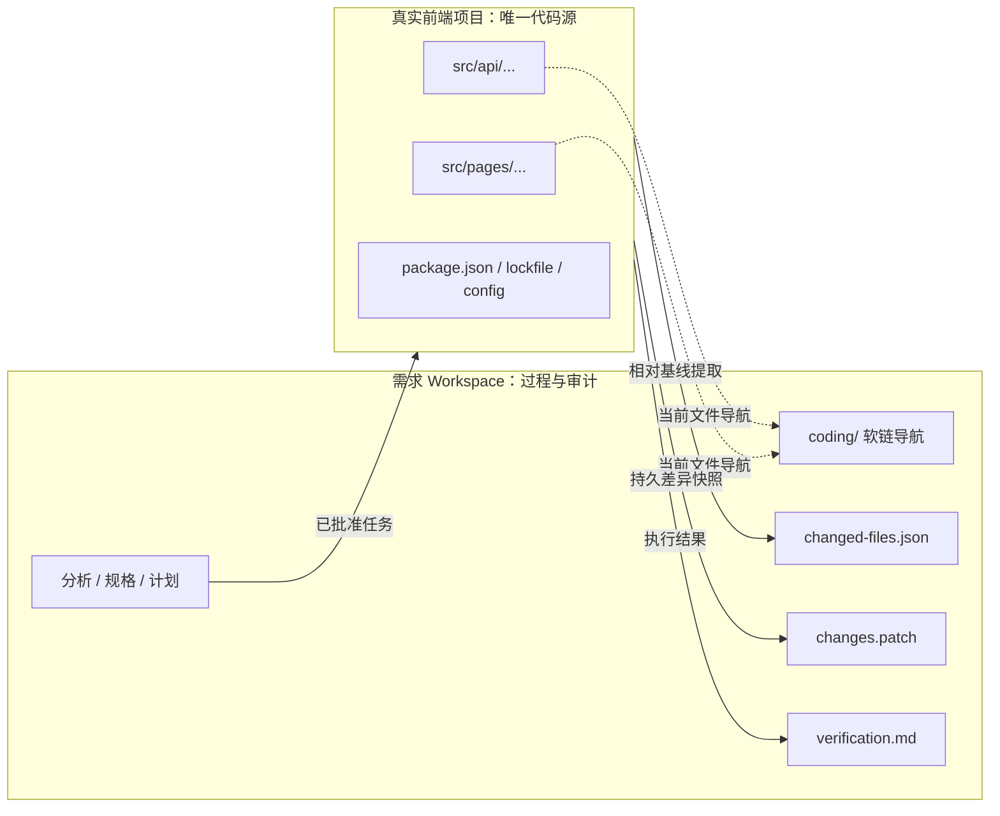

- AI 检索、修改、启动和验证的对象始终是真实项目，不通过软链执行。
- `coding/` 只是让审核者快速聚合和跳转到本需求涉及的当前文件。
- 软链会随当前代码变化，因此不能承担历史快照职责。
- `changes.patch` 保存最终差异，才是可持久审查的代码记录。
- `changed-files.json` 区分新增、修改、删除，并标记文件是否与需求开始前已有改动重叠。
- 删除文件没有可用软链，只记录在清单和 Patch 中。

### 7.2 Workspace 在真实开发中的使用目的

Workspace 的目的不是“多生成一套文档”，而是为一次需求建立一个不依赖单次对话窗口的、可继续执行的上下文边界。

#### 场景一：AI 会话中断或换了 Agent

一个需求可能跨越几天，中间会关闭 Cursor、切换 Codex 任务，或者因为上下文过长重新开会话。如果只有聊天记录，新 Agent 很难知道：

- 哪些结论来自 PRD，哪些只是上一个 Agent 的推断。
- 哪些范围已经由开发人员确认。
- 当前执行到哪个阶段。
- 哪些任务已经完成、哪些还没有。

Workspace 用 `status.json` 和结构化产物保存这些事实。新会话先读取状态和产物即可继续，而不是要求开发人员重新讲一遍需求。

#### 场景二：项目开始前已经有本地改动

前端开发经常在非干净工作区中继续开发。如果只看最终 `git diff`，AI 本次修改和开发者原有修改会混在一起。

初始化需求时记录 `baseCommit`、分支和 `initialChanges`；最终 `changed-files.json` 对重叠文件标记 `preExisting`。这不能自动拆分同一文件里的每一行归属，但可以显式提醒审核者：该文件不是由本需求从干净状态独占修改。

#### 场景三：一次需求修改的文件分散

一个前端需求可能同时改页面组件、状态管理、API 封装、类型和测试。开发者若只看目录树，很难快速聚合本需求涉及的文件。

`coding/` 按原项目相对路径建立软链，让审核者从需求目录直接跳到当前文件；`changed-files.json` 提供机器可读清单；`changes.patch` 保存最终差异。三者分别解决“快速导航、程序处理、持久审查”，不能互相替代。

#### 场景四：代码已经删除或继续发生变化

被删除的文件无法建立有效软链；现存文件的软链也会随着真实项目继续编辑而变化。因此软链不能证明某个时间点的最终内容。

删除项保存在清单和 Patch 中，最终差异由 `changes.patch` 承担。Workspace 明确区分“当前导航”和“历史快照”，避免把软链误当备份。

#### 场景五：需求在实施中发生变化

开发人员可能在实施阶段修改空态、接口字段或交互规则。若只改技术方案，旧任务、旧追踪和旧验证仍可能被继续使用。

Workspace 中的 artifact graph、`staleArtifacts` 和 `revisions/` 让影响范围显式化：谁发生变化、哪些下游需要刷新、哪些批准已经失效，都有机器可读记录。

#### 场景六：不希望再增加一套 PR 流程

团队已经会在真实业务仓库完成代码 Review。为 AI 工作流再创建隔离 Worktree 和额外 PR，会重复现有流程，也可能让页面运行环境与开发者当前配置不同。

Workspace 保存需求审核需要的范围、方案、文件列表、Patch 和验证证据，但不代替业务仓库的 Git 流程。开发者仍在熟悉的分支和本地环境里验收、提交与发起正式 PR。

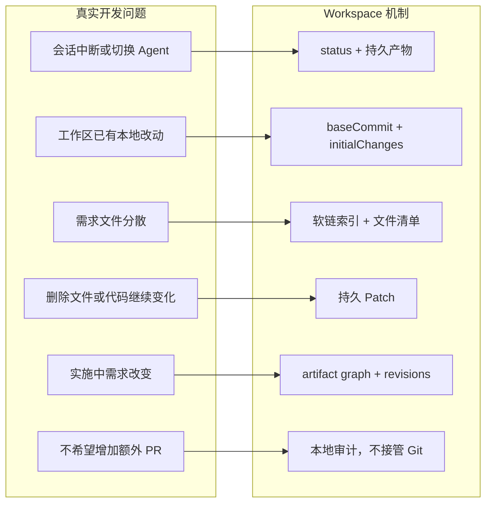

#### Workspace 明确不是什么

- 不是业务源码副本。
- 不是强制 Worktree。
- 不是 Git 分支或提交的替代品。
- 不是自动回滚工具。
- 不是把所有聊天内容原样堆进去的日志目录。

它保存的是后续阶段真正需要复用和审核的结构化事实。

### 7.3 需求 ID

需求目录 ID 按以下顺序确定：

1. PRD 中存在业务需求编号时，使用规范化后的编号。
2. 开发人员显式提供编号时，使用该编号。
3. 只有需求名称时，生成 `REQ-YYYYMMDD-XXXXXX`。

需求名称单独保存为 `status.json.title`。后续名称变化或补充正式编号不会重命名目录，避免路径、引用和审计记录失效；补充编号写入 `externalIds`。

## 8. 状态机与产物一致性

### 8.1 状态机只表示“现在执行到哪里”

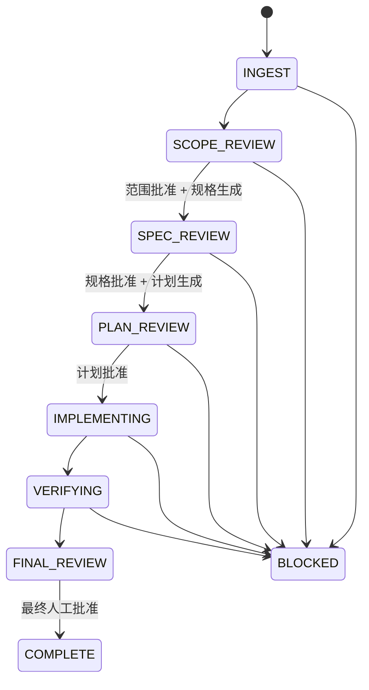

`status.json.state` 不承担“所有上游文档是否仍然有效”的职责。这个职责由 `status.json.consistency` 独立承担。

### 8.2 为什么设计成“阶段状态 + 一致性状态”

只用一个流程状态会把两个不同问题混在一起：

- **阶段状态**：Agent 当前应该做分析、规格、计划、编码还是验证？
- **一致性状态**：当前阶段依赖的上游产物还是不是最新的？

如果用“回退阶段”表达产物过期，就无法区分“真正重新开始做规格”和“实施阶段临时修正规格后同步下游”。因此 `status.json` 使用二维模型：

| 维度 | 字段 | 回答的问题 | 变化方式 |
| --- | --- | --- | --- |
| 执行进度 | `state` | 现在执行到哪里、允许做什么 | 审核通过并完成阶段工作后向前迁移；阻断时进入 `BLOCKED` |
| 上下文新鲜度 | `consistency.revision` | 上游产物发生过多少次受控修改 | 每次 `mark` 自增 |
| 待同步集合 | `consistency.staleArtifacts` | 哪些下游产物不能继续作为有效上下文 | artifact graph 传播后加入，实际刷新后 `resolve` |
| 最近变化 | `consistency.lastChange` | 最近修改了什么、对应哪条 revision | 每次 `mark` 更新 |
| 人工授权 | `approvals.*` | 哪些决策边界已经由人确认 | 由人批准；受影响的上游变化会使其失效 |

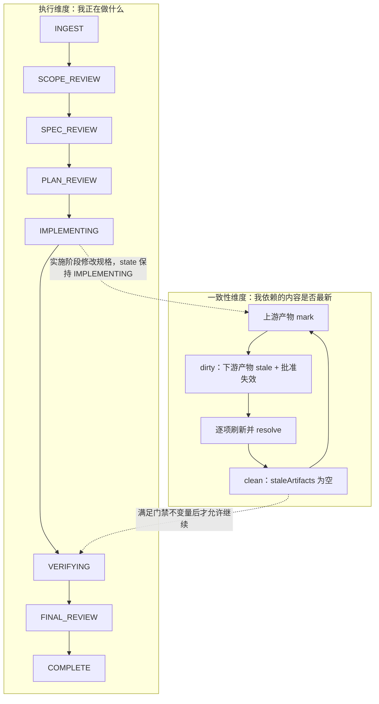

这不是为了增加状态数量，而是避免使用一个字段表达两个语义。开发者看到 `state` 可以知道流程位置；Agent 读取 `staleArtifacts` 可以知道当前上下文是否安全。

### 8.3 状态迁移契约

状态机的价值不是展示一条箭头，而是约束每个节点的允许动作和离开条件。

| 当前状态 | Agent 可以做什么 | 进入下一状态的条件 | 必须停止的情况 |
| --- | --- | --- | --- |
| `INGEST` | 读取输入和仓库；生成 analysis 产物 | 来源、证据、范围和待确认问题已生成 | 不得修改业务代码 |
| `SCOPE_REVIEW` | 展示范围、职责、冲突和未知事项 | 人工批准 scope 后才能生成规格 | 存在未确认范围或文档冲突 |
| `SPEC_REVIEW` | 展示前端行为、验收和契约缺口 | 人工批准 spec 后才能生成计划 | 行为、空态、失败态或接口消费不闭环 |
| `PLAN_REVIEW` | 展示真实文件范围、任务和验证方案 | 人工批准 plan 后才能修改代码 | 文件未定位、方案依赖推断或超出范围 |
| `IMPLEMENTING` | 一次执行一个已批准任务 | 已批准任务完成，并生成最新代码留痕 | 新需求、契约变化、越界或已有改动冲突 |
| `VERIFYING` | 运行真实项目命令和页面验收 | 验证记录完整且 `staleArtifacts` 为空 | 测试失败、页面未验证或差异仍变化 |
| `FINAL_REVIEW` | 展示最终 Patch、追踪和剩余风险 | 人工批准 final | AI 不得自行宣布可合并 |
| `COMPLETE` | 保存完整审计结果 | 无自动后续动作 | commit、push、PR、merge、deploy 仍需单独授权 |
| `BLOCKED` | 记录阻断事实和所需输入 | 人工补充信息后回到适当执行阶段 | 不得用 Agent 推断绕过阻断 |

任何审核点都必须同时满足四个不变量：

1. 当前阶段要求的产物存在且结构有效。
2. `staleArtifacts` 为空。
3. 阻断性 `open-questions` 已关闭或明确排除。
4. 所需批准由人工记录，Agent 不能代填。

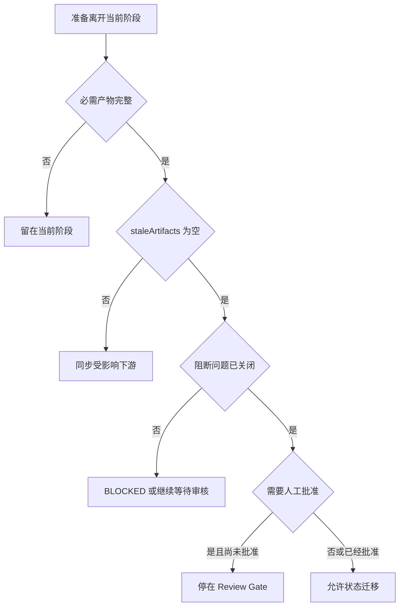

### 8.4 为什么修改需求后不回退状态

假设当前已经在 `IMPLEMENTING`，开发人员修改了 `frontend-spec.md`：

- 回退到 `SPEC_REVIEW` 会让流程语义混乱，并可能重复执行已经完成且仍有效的步骤。
- 继续向前但不处理旧产物，会让旧任务和旧验证继续污染上下文。
- 当前方案保持 `IMPLEMENTING`，根据产物依赖图把受影响的下游内容标为过期，在当前阶段原地同步，并使相关人工批准失效。

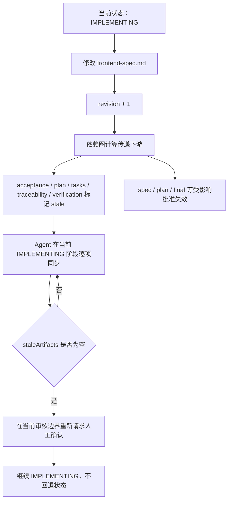

### 8.5 `revisions/` 的意义

每次上游变化都会产生 `revision-NNNN.json`，记录：

- 在什么状态修改了哪个产物。
- 哪些下游产物失效。
- 哪些人工批准被清除。
- 哪些产物已经同步、还有哪些未同步。

它是上下文一致性的审计记录，不是代码回滚系统，也不是要求流程退回旧节点。

## 9. 产物之间如何形成追踪链

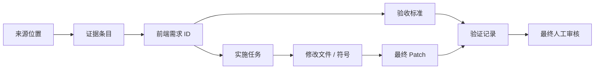

`traceability.md` 的核心作用，是让审核者能够双向追踪：

- 从某条 PRD 找到对应规格、任务、代码和验证。
- 从某个修改文件反查它由哪条需求和哪项任务授权。

这比单独保存一份技术方案更重要，因为它把“为什么改、改了什么、如何证明”连接成一条链。

## 10. 多 Skills 的团队化设计

### 10.1 当前选择

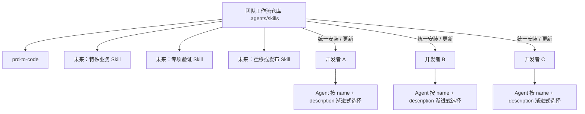

- 团队仓库中的 `.agents/skills/` 是统一分发边界。
- 安装器复制全部 Skills，不要求每位开发者手工选择或维护组合。
- 每个 Skill 保留自己的 `name`、`description` 和渐进式加载机制。
- 现阶段 Skills 数量较少，不提前增加顶层路由、Profile 或触发数量限制。
- 将来只有在实际测量发现 token、延迟或误触发问题后，再治理描述重叠、拆分领域包或增加路由层。

### 10.2 为什么不让个人单独配置

个人配置虽然灵活，但会导致：

- 安装和升级成本落到每个开发者身上。
- 同一条需求在不同电脑上可能得到不同工作流行为。
- Skill 修复后无法保证团队及时同步。
- 问题难以复现，因为每个人的 Agent 能力集合不同。

因此当前阶段优先保证团队一致性，同时不限制单个 Skill 的自主触发能力。

## 11. 使用体验上的优势

### 11.1 开发人员不需要先学习一套方法论

通用开源方案为了适应不同团队，会提供多套命令、角色、Schema、Track、扩展或 Preset。这些能力对平台化很有价值，但公司前端开发的日常入口可以更窄：

1. 在当前前端项目中打开 Codex 或 Cursor。
2. 提供 PRD、接口文档、原型和必要的自然语言补充。
3. Agent 自动识别需求 ID、真实项目技术栈和当前阶段。
4. 开发者只在范围、规格、计划和最终 Diff 等关键边界审核。
5. 代码仍在当前项目中运行和验收。

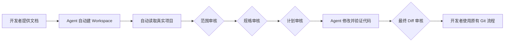

开发者需要理解的是“当前审核什么”，而不是先理解工作流引擎内部所有概念。

### 11.2 与实际开发习惯保持一致

| 实际使用问题 | 当前设计的体验 | 带来的价值 |
| --- | --- | --- |
| 每个项目的 Vue、React、Node 和包管理器不同 | Agent 读取仓库证据，不要求开发者先选 Profile | 降低错误配置和项目适配成本 |
| 页面必须依赖本地代理、环境变量或未提交配置才能运行 | 直接在开发者当前项目执行 | 人与 AI 看到相同页面环境 |
| 团队已有正式 PR 和 Review 流程 | 工作流不再自动制造一层额外 PR | 避免重复 Review 和分支管理 |
| PRD、接口和原型需要反复补充 | 中间产物可修改，并显式传播下游影响 | 修改需求时不必整段重跑 |
| Agent 会话可能中断 | Workspace 作为稳定重入点 | 换会话后继续当前阶段 |
| 改动文件散落在仓库 | 需求目录集中展示软链、清单和 Patch | Review 时快速聚焦本需求 |
| 开发者只想处理前端范围 | 后端和跨仓库事项显式标记但不生成占位代码 | 避免 AI 为了闭环而越界实现 |

### 11.3 审核发生在“最值得花人力”的位置

如果每生成一份文件都要求点击确认，工作流会过于繁琐；如果只在最后审核，错误已经扩散到全部代码。当前方案选择四类语义边界：

- **范围审核**：确认做什么、不做什么。
- **规格审核**：确认用户能观察到的行为。
- **计划审核**：确认要改哪些真实文件、如何验证。
- **最终审核**：确认最终代码差异和剩余风险。

这四个边界把审核从“看 AI 写了多少内容”转成“做关键决策”。产物内部的机械同步由 Agent 完成，决策权仍在人。

### 11.4 相对通用方案的体验优势与代价

当前方案的体验优势来自“场景更窄”，并不是能力全面超过通用开源方案：

- 启动时不要求选择项目类型、角色体系或工作流 Track。
- 不要求改变团队现有分支、PR、合并和发布方式。
- 公司 PRD 和接口文档是一等输入，而不是先手工改写成通用 Feature Prompt。
- 前端职责分类、接口消费和页面验收被放到默认流程中。
- 状态、一致性和审核信息集中在一个需求目录，Agent 可以稳定恢复。

相应代价是：

- 当前缺少 Spec Kit 那样成熟的多 Agent 集成与扩展生态。
- 缺少 OpenSpec 已经打磨成熟的命令、同步和归档体验。
- 缺少 BMAD 针对产品、架构、UX、Story 的完整角色和复杂度适配。
- 当前快捷触发、安装更新和 `BLOCKED` 恢复信息仍需要继续完善。

因此近期目标应是先证明前端小组真实需求上的成功率和审核效率，而不是立即扩展成覆盖全部研发角色的平台。

## 12. 质量保障不是一次检查，而是四层防线

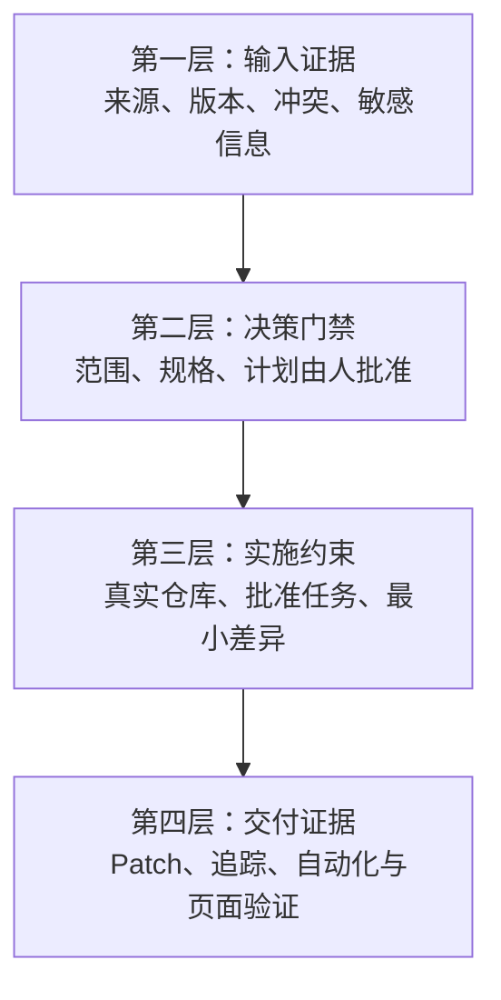

关键控制点包括：

- 每条重要结论必须有文档来源、用户确认或仓库证据。
- 冲突、推断和接口缺口不能直接转为实施任务。
- AI 不能代替人工填写批准记录。
- 审核前运行 Workspace 校验，过期产物不为空时不能过门禁。
- 修改代码前记录基线提交、分支和已有未提交文件。
- 只实施已经批准的任务，并保留项目原有改动。
- 使用仓库真实存在的命令验证，不凭空规定测试体系。
- 工作流不自动 commit、push、创建 PR、merge 或 deploy。

## 13. 当前已经落地的能力

在 `feat/sdd-workflow-v0.2` 分支中已经具备：

- 团队 Skills 与项目模板的安装器。
- `prd-to-code` Skill 及 Codex / Cursor 共用目录结构。
- 需求 Workspace 初始化与自动需求 ID。
- 项目根目录、分支、基线提交和已有改动记录。
- 完整的分析、设计、代码变更和验证产物模板。
- 状态与一致性分离的数据结构。
- 基于产物依赖图的 stale 传播、批准失效和 revision 记录。
- 真实项目修改文件的软链索引、文件清单和最终 Patch。
- Workspace 结构、状态、批准和 stale 状态校验。
- 自动化测试覆盖安装、初始化、一致性和代码变更记录。

## 14. 当前仍需完善的使用体验

以下内容不能被描述为已经完成：

1. Cursor 项目规则中仍有一处旧路径 `.ai-dev/changes/<change>`，应修正为 `.ai-dev/features/<requirement-id>`。
2. 当前没有独立的 `.cursor/commands/prd-to-code.md`，因此 `/prd-to-code` 的快捷入口在不同 Cursor 版本中的可见性还不够稳定。
3. Codex 项目级 Skill 文件已经安装，但 `$prd-to-code` 是否即时显示还受到项目根目录、任务刷新和客户端发现机制影响，需要补充稳定的兜底入口与验证说明。
4. 试点阶段采用“将完整工作流仓库 clone 到前端项目，再执行本地 setup”的方式便于观察和调试；正式推广前还需要统一版本标签、更新和卸载体验。
5. 当前不会限制顶层 Skills 数量；未来是否增加治理机制，应依据真实 token、延迟和误触发数据决定。
6. `BLOCKED` 已进入状态枚举，但当前 `status.json` 尚未单独保存进入阻断前的状态和恢复目标；正式使用前应明确恢复契约，避免 Agent 自行判断回到哪个阶段。

这些问题主要影响“如何快捷启动和团队推广”，不改变 SDD 主流程、Workspace 结构和一致性机制。

## 15. 推荐的后续优化顺序

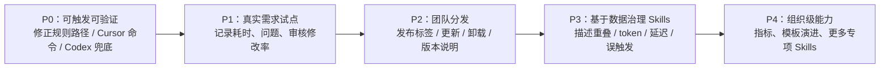

不建议在当前阶段提前建设复杂的框架版本矩阵、强制 Worktree、额外 PR 流程或多层 Skill 路由。应先用真实前端需求验证：

- 范围审核能否减少错误理解。
- 技术方案是否能准确映射真实文件。
- 中途修改需求时，一致性传播是否有效。
- 最终 Patch 和追踪链是否让 Review 更快。
- 开发人员是否愿意持续使用，而不是只在演示时使用。

## 16. 最终价值

这套工作流把 Agent 从“直接写代码的工具”变成“受证据和人工决策约束的执行者”：

- 对开发人员：减少重复分析和文档整理，同时保留关键决策权。
- 对审核者：在范围、方案和 Diff 三个边界提前发现问题，而不是最后一次性面对全部代码。
- 对团队：统一 Skill、产物和审核语言，使不同项目的执行过程可复现。
- 对管理者：每个需求都能回答来源、决策、改动、验证和风险，不依赖口头解释。

因此，当前方案选择的不是“自动化程度最高”的路径，而是 **在真实前端开发环境中，当前最容易验证、最容易审查、最容易逐步推广的路径**。

## 17. 开源方案参考资料

横向对比基于以下项目官方资料核对，时间为 2026-09-07：

- GitHub Spec Kit：[项目 README](https://github.com/github/spec-kit/blob/main/README.md)、[文档首页](https://github.com/github/spec-kit/blob/main/docs/index.md)、[Workflow 说明](https://github.com/github/spec-kit/blob/main/workflows/README.md)。
- OpenSpec：[Overview](https://github.com/Fission-AI/OpenSpec/blob/main/docs/overview.md)、[Concepts](https://github.com/Fission-AI/OpenSpec/blob/main/docs/concepts.md)、[Commands](https://github.com/Fission-AI/OpenSpec/blob/main/docs/commands.md)、[Editing changes](https://github.com/Fission-AI/OpenSpec/blob/main/docs/editing-changes.md)。
- BMAD Method：[Getting started](https://github.com/bmad-code-org/BMAD-METHOD/blob/main/docs/tutorials/getting-started.md)、[Workflow map](https://github.com/bmad-code-org/BMAD-METHOD/blob/main/docs/reference/workflow-map.md)。

这些资料用于确认各方案公开描述的定位、主流程和使用方式。表格中的“当前 Frontend SDD”评价属于结合公司前端场景做出的设计取舍，不代表对开源项目的通用能力排名。
