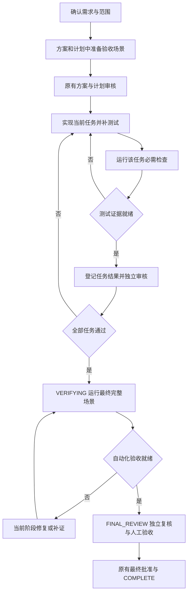

# 需求驱动的自动化验收改造方案

状态：待评审。日期：2026-11-15。

本次交付仅为方案文档。本文中的新增文件、字段、命令参数和校验规则均为拟实施内容，不表示当前已支持。

改造目标是在现有前端工作流中补上“已确认需求 → 验收场景 → 实际测试 → 当前版本证据 → 独立审核”的链路。开发人员仍提交 PRD、审核方案和最终页面；AI 在交付前运行真实项目中的需求场景，并明确展示通过、失败和未验证项。

主接入点是现有 `VERIFYING` 阶段；验收场景在方案阶段准备，任务相关测试在提交独立审核前运行。沿用现有阶段和人工审批权限。第一版先跑通一个浏览器验收方案，再用真实需求验证投入和效果。

## 一 使用上的变化

| 使用环节 | 接入后的行为 | 开发人员需要做什么 |
| --- | --- | --- |
| 项目首次接入 | 从仓库确认启动方式、已有测试、登录方式和数据准备方式 | 补充仓库中无法获得的测试环境或账号使用条件 |
| 方案审核 | 同时展示需求场景、预期结果、自动化范围和人工项 | 在原有审核中确认关键业务预期，不逐条阅读测试代码 |
| 任务开发 | 主 Agent 实现功能和测试，运行相关检查，再交独立 reviewer | 通常无需额外操作 |
| 整体测试 | 在最终代码上操作真实页面，验证完整流程和受影响回归 | 只有业务歧义或无法自行解决的环境条件才需要介入 |
| 最终验收 | 展示逐条验收结果、运行环境和失败证据 | 查看页面、确认明确保留的人工项，按原流程决定是否交付 |

不增加一轮独立的“测试方案人工审批”。测试预期与执行计划分别并入现有方案、计划审核；后续变更仍遵守已有的一致性与重新审批规则。

## 二 当前基础与实际缺口

以下依据为检查时的工作区文件；仓库存在原有未提交修改，不能只用 HEAD 代表全部材料。检查时 HEAD 为 `b540c30a8468bb6e3e959eb25c4991993ab3f6b0`。

| 已有能力与位置 | 目前能证明什么 | 本次要补什么 |
| --- | --- | --- |
| [delivery.mjs](../../template/.ai-dev/scripts/lib/delivery.mjs) 的 `validateDelivery` | FR、AC、任务的引用存在；AC 有 given、when、then、verification | 明确场景对应的测试、执行环境、实际断言和验证方式；字段非空不代表覆盖充分 |
| [verification.mjs](../../template/.ai-dev/scripts/lib/verification.mjs) 的 `runVerification` | 实际执行命令，保存退出码和输出 | 解析逐用例结果；区分工程检查与需求验收；为整单验证提供独立入口 |
| 同一执行器的快照逻辑 | 提供 `expectedSnapshotId` 时会执行前后校验；未提供时只在执行后抓快照 | 执行器始终自行获取执行前快照，执行后及消费结果时再次核对 |
| [gates.mjs](../../template/.ai-dev/scripts/lib/gates.mjs) 的 final 分支 | 任务有审核通过记录，且验证记录中至少有一条 passed | 检查全部必需命令、全部必测场景及其当前版本证据，禁止历史成功掩盖漏跑或失败 |
| [task-runs.mjs](../../template/.ai-dev/scripts/lib/task-runs.mjs) 的 `acceptTaskResult` | DONE 转为 `review_pending`，保存上报的 verificationIds | 核实引用的记录及任务检查是否就绪，不能只接受一组 ID |
| [workflow-state.mjs](../../template/.ai-dev/scripts/lib/workflow-state.mjs) | 状态按相邻节点推进；进入 `FINAL_REVIEW` 的前置门禁映射仍为 plan | 在进入最终审核前增加自动化验收就绪检查，不能仅依赖 Skill 提醒 |
| [orchestrator.mjs](../../template/.ai-dev/scripts/lib/orchestrator.mjs) | `VERIFYING` 返回通用 verify 动作 | 返回具体待执行检查、失败后的修复或补证动作，以及是否可进入最终审核 |
| [review-adapter.mjs](../../template/.ai-dev/scripts/lib/review-adapter.mjs) 的 `mapChecks` | 将独立审核包转成工作流报告 | 当前缺少规则直接映射时会借用首条检查结果；验收规则必须直接映射，缺项应保持 not_run |
| [prepare-review](../../.agents/skills/prepare-review/SKILL.md) 与 [review-delivery](../../.agents/skills/review-delivery/SKILL.md) | 已要求需求来源、独立上下文、实际测试记录及未验证项 | 增加对需求遗漏、测试断言、运行对象和测试有效性的专项核对 |

本次会话此前已用临时 fixture 复现：一条检查通过、一条失败、一条未运行时，`evaluateGate('final')` 的结构校验仍可通过；未传入执行前快照时，运行中修改源码也可得到 passed。这两个实验针对具体函数，不代表已经绕过完整的人工作业流程。

另一个直接可复核的基线是 [retry-state 样例](../../eval/cases/retry-state/prd.md)：本轮执行 `node --test eval/fixtures/retry-state/test/request.test.mjs`，3 条辅助逻辑测试全部通过；[页面源码](../../eval/fixtures/retry-state/src/app.js) 只绑定加载按钮，没有重试入口。这是“辅助逻辑检查成功，页面需求仍未完成”的现成样例。这里的页面结论来自源码核对，尚未新增或执行浏览器验收。

## 三 接入当前工作流的位置

保留当前主状态链：

```text
INGEST → SCOPE_REVIEW → SPEC_REVIEW → PLAN_REVIEW
  → IMPLEMENTING → VERIFYING → FINAL_REVIEW → COMPLETE
```

“编写方案”和“编写计划”是已有节点之间的工作内容，不新增 SPEC、PLAN 或 TEST_REVIEW 主状态。



### 3.1 开发前准备

方案阶段根据确认需求写 AC，即验收标准，说明用户能观察到的行为。计划阶段再补测试入口、数据、步骤、断言、执行命令和环境。不能在代码写完后，把当前实现的行为反过来填成预期结果。

正常、加载、空数据、失败恢复、边界、重复操作、权限或并发是检查视角，按需求适用性选取。没有需求或契约依据时记录问题，不自动新增业务规则。

### 3.2 任务测试

主 Agent 在 `IMPLEMENTING` 中实现当前任务和相关测试，运行计划要求的任务检查。检查成功后，才通过 `record-task-result accept` 登记 DONE，并进入 `review_pending`。随后沿用当前机制立即派独立 reviewer。

只有该任务已具备执行条件的场景才作为任务完成的前置条件。跨任务页面流程放到整单验收，不能让 T1 等待尚未实现的 T2。单元测试、组件测试和 lint 等工程检查继续使用项目已有命令。

任务测试失败时，任务保持执行中；可以提交明确的 BLOCKED 或 NEEDS_CONTEXT 结果，但不能把失败伪装成 DONE。将来实现任务入口校验时，必须同时覆盖正常、失败、阻塞和幂等提交分支。

### 3.3 整单测试

全部任务独立审核通过后，进入 `VERIFYING`。在同一份最终候选代码上运行整单必需检查，包括完整用户流程和计划明确的回归场景。任务阶段的历史通过记录不代替这次验证。

第一版对代码、测试、fixture、测试配置或相关契约变化采用保守策略：整单必测集重新执行。暂不构建复杂的测试影响分析系统。

### 3.4 最终审核与人工项

进入 `FINAL_REVIEW` 前，所有必需自动化检查必须完成并通过；明确在计划中保留的人工项可以仍处于“待确认”，以便人在这个阶段实际操作页面。

人工检查不是自动化通过。收到真实确认后记录对应检查项、检查对象和 `confirmationRef`，补入审核材料并重新封存，独立 reviewer 复核受影响项，再按原流程记录 final 批准。scope/final 仍由人批准；spec/plan 继续遵守当前 strict 或已明确授权的 delegated-review 模式。

## 四 如何使验收依据来自需求

### 4.1 每个用例的最低信息

业务验收用例保存以下信息，沿用现有 FR 和 AC 编号；TC 只标识具体测试用例，不建立第二套需求台账。

| 信息 | 用途 |
| --- | --- |
| 关联 AC 及其需求来源 | 说明为什么要测；通过 AC → FR → evidence 回查已确认原文或决策 |
| 前置状态与测试数据 | 明确角色、页面状态、数据条件及初始化方式 |
| 用户操作步骤 | 必须能在实际项目中执行，不能只写“验证正常” |
| 可观察的预期 | 页面文案、可操作状态、请求参数、请求次数、路由或持久化结果 |
| 执行方式和环境 | 自动化、人工或静态检查；本地受控响应、真实测试接口或设备环境 |
| 测试实现位置与稳定 ID | 对应报告中的具体测试，避免用整个命令的成功冒充单个场景成功 |
| 必测节点 | 当前任务、最终整单，或两者都需要 |

每条纳入范围的 AC 都要有明确验证安排。纯工程检查可引用项目规则；要求保留的用户行为，应在确认的 AC 中说明并纳入回归。人工和静态检查只覆盖其已确认范围，不能在自动化失败后临时变更方式来放行。

### 4.2 重试需求的完整示例

下列场景均可从已有 [PRD](../../eval/cases/retry-state/prd.md) 的成功、加载、失败、重复操作和异常恢复描述中找到依据。示例标签不替换现有评测文件中的编号。

| 场景 | 准备与操作 | 实际断言 | 能发现的错误 |
| --- | --- | --- | --- |
| 正常加载 | 返回固定资料，点击加载 | 显示成功和对应资料内容 | 页面没有消费真实响应、成功路径回归 |
| 加载中 | 暂缓响应 | 响应完成前呈现 loading；完成后离开 loading | 加载状态未展示或提前清除 |
| 请求失败 | 返回 HTTP 500 | 展示错误和可用重试入口，离开 loading | 只捕获异常却没有可操作的恢复入口 |
| 失败后恢复 | 先失败，再点击重试并返回另一份固定资料 | 新请求符合契约；展示新资料；原错误消失 | 按钮未绑定、展示旧数据、错误状态残留 |
| 重复操作 | 保持请求 pending，连续操作加载或重试 | pending 期间实际网络请求数仍为 1 | 页面重复请求、仅辅助函数有防重但调用链绕过 |

测试应打开该项目实际页面、使用实际路由和组件。可以在网络边界构造有契约依据的响应；不能通过直接改 DOM、写业务 store 或重写一份业务算法来制造预期结果。数据初始化可使用既有测试接口或 fixture，但被验收的操作必须经过真实用户链路。

### 4.3 独立审核的具体职责

复用现有 reviewer，先独立对照确认原文查遗漏，再查看用例和脚本。重点核对：

1. 每项测试预期是否与需求一致，是否遗漏需求中明确的状态或恢复路径。
2. 脚本是否实际到达前置状态、执行对应操作，并对关键结果作断言。
3. 是否只有按钮可见性检查，却没有验证点击后的请求和业务结果。
4. mock 是否位于契约边界，是否掩盖了本次要验证的业务逻辑。
5. 运行报告是否来自当前项目和当前测试版本，新增测试结果是否重新制包。

把 AC 写进测试标题只证明关联存在。JSON 校验可以检查引用和执行完整性，不能自动证明原文抽取完整、断言语义正确。独立审核和后文的缺陷反例测试共同补足这一层。

## 五 最小实现结构与产物

### 5.1 职责分配

| 组成 | 负责的内容 |
| --- | --- |
| 主 Agent 与拟新增的 `acceptance-testing` Skill | 根据需求设计用例、查清环境、编写测试、执行和排障；不自行批准需求 |
| 项目已有测试工具 | 执行测试与断言；首个浏览器接入使用 Playwright |
| 工作流 Node 脚本 | 执行已登记命令、绑定快照、读取报告、校验必测项、持久化结果和判断准入 |
| 现有独立 reviewer | 核对需求完整性、测试质量、实际证据及剩余风险 |
| 开发人员 | 确认业务歧义、实际人工项和已有审批节点 |

Node 继续不调用模型或派发子 Agent；宿主按照下一步动作调用 Skill 和 reviewer。新增 Skill 负责工作方法，不能承担只能靠程序约束的准入条件。

### 5.2 单一的定义来源

建议将 `delivery.json` 升为 schemaVersion 2，保持 `intake.json` 的需求来源职责不变。schema 变化需要显式迁移，不把新增字段默默塞入旧协议后继续按旧规则放行。

| delivery v2 字段 | 设计 |
| --- | --- |
| `acceptance` | 保留现有 AC、FR 关联及 given/when/then；`verification` 收敛为 test/manual/inspection，混合场景拆成可判断的 AC |
| `testCases` | 保存上节定义的具体场景；自动化用例包含 `implementation.file`、`implementation.testId`，人工/静态项省略自动化实现 |
| `verification.environments` | 保存按仓库证据确定的环境描述、启动入口、健康检查、数据重置和测试工具配置引用；明确接口契约版本、mock 范围及真实联调条件；只保存凭据引用，不存凭据值 |
| `verification.checks` | 统一保存稳定 `checkId`、kind、command、args、cwd、环境、caseIds 和报告格式；命令只定义一次 |
| `tasks[].verifyIds` | 引用该任务必须执行的 checks，替代 v1 内嵌的 `tasks[].verify` 命令数组 |
| `verification.finalCheckIds` | 最终候选代码上必须重跑的 checks；允许复用任务 check 定义，但执行记录的 scope 不同 |
| `links` | 保留现有 FR → AC → task 关系 |

`kind=engineering` 的命令证明 lint、构建或已有测试命令的结果；`kind=acceptance` 的命令必须提供可解析的逐用例报告。第一版实现通用命令记录和 Playwright JSON 读取，不承诺同时兼容所有测试工具。其他工具已有测试继续运行；要用其报告证明逐条业务验收，需补对应读取能力，不能靠日志关键字推断。

每个自动化业务用例声明 `requiredAt`，至少包含 feature；可额外包含 `task:T1`。计划校验核对 finalCheckIds 能覆盖所有 feature 必测用例，防止删掉执行命令后把漏测项隐藏掉。人工和静态项也关联最终验收，但由各自证据方式闭环。

字段完整性按阶段判断：方案交审时必须明确 AC 的来源、可观察预期和验证方式；计划交审时再补齐用例、check、环境与文件操作声明；执行和交审时核验实际文件、服务和证据。不能要求方案阶段已经有实现代码或运行结果，也不能在最终阶段继续接受“计划创建”的测试作为已执行证据。

以下为拟定的单个用例结构示意，引用 ID 需替换为目标需求真实台账中的值，不是完整或可执行的 delivery 文件：

```json
{
  "id": "TC-RETRY-RECOVER",
  "acceptanceIds": ["AC-RETRY-RECOVER"],
  "method": "browser",
  "environmentId": "local-contract-mock",
  "requiredAt": ["feature"],
  "preconditions": ["用户已进入个人资料页", "接口预置为首次请求返回 500，第二次返回固定资料"],
  "dataRef": "tests/fixtures/profile.json",
  "steps": ["点击加载", "等待失败提示", "点击重试"],
  "expectations": [
    {"id": "E1", "observable": "network", "expected": "点击重试后新增一次正确的资料请求"},
    {"id": "E2", "observable": "ui", "expected": "展示重试响应中的资料，原错误提示消失"}
  ],
  "implementation": {
    "file": "tests/e2e/profile-retry.spec.ts",
    "testId": "TC-RETRY-RECOVER"
  }
}
```

这里的 expectations 是具体 AC 的执行展开，不能引入与 AC 冲突的新规则。测试实现路径在计划阶段可以按 create 登记；真正执行和交审时必须存在。

### 5.3 文件归属

```text
业务项目原有测试目录
  测试脚本、fixture、测试配置             持续用于后续回归

.ai-dev/features/<id>/artifacts/design/
  delivery.json                         验收与执行计划的定义来源
  acceptance.md                         从定义生成的可读场景

.ai-dev/features/<id>/revisions/verifications/<runId>/
  record.json                           本次执行身份、版本、环境、结果
  raw-report.json                       测试工具原始结构化输出
  stdout.log / stderr.log               实际命令输出
  evidence/                             截图、trace 等证据

.ai-dev/features/<id>/artifacts/verification/
  acceptance-results.json               从有效运行记录计算的当前汇总
  verification.md                       给人的逐条结果、失败和人工项
```

测试源文件和 fixture 进入业务仓库正常测试目录及需求改动清单，不放进只保存运行产物的目录。汇总 JSON 和 Markdown 都是派生视图；门禁要复核原始记录和摘要，不能只读取汇总中的 passed。

## 六 执行器怎样完成一次真实验收

### 6.1 环境准备

按真实项目选择 Node、包管理器、启动命令和测试工具版本，不要求业务项目为了工作流整体升级运行时。已有浏览器测试优先复用；新增 Playwright 时先验证与项目启动环境的兼容性并锁定实际版本。

首个接入以本地真实项目加受控接口响应为主。启动、关闭本次创建的服务，等待可观察的服务就绪条件；不因端口能访问就默认服务来自当前项目。可复用的服务须能核对项目、进程或构建身份。Playwright 提供服务启动与就绪等待能力，但工作流仍需明确服务归属和复用条件。[官方 Web server 文档](https://playwright.dev/docs/test-webserver)

测试使用可重置的数据和隔离会话，避免依赖上次测试残留的登录、缓存或业务数据。实际业务操作要求哪些角色、数据和功能开关，应写入环境记录；相关条件变化后重跑。

真实接口验证单独标识 `live-test` 环境，受控响应标识 `contract-mock`。mock 结果不能代替后台鉴权、真实字段或持久化的联调证明；外部依赖不可用时保留未验证范围。

### 6.2 运行协议

复用 `run-verification.mjs`，将请求扩展为 `scope=task|feature` 与稳定 `checkId`。task 运行绑定 taskId 和 attemptId；feature 运行不伪造任务 ID。旧 `commandIndex` 仅用于兼容诊断，不能作为 v2 记录身份。

执行顺序：

1. 读取当前已确认的 delivery 和任务/阶段，解析 checkId，验证它属于本次允许执行的清单。
2. 确认环境、测试文件和 fixture 可用。为本次运行创建唯一目录，输出位置由执行器分配，不复用旧报告文件。
3. 在执行前自动捕获输入快照。调用方提供的预期快照仅作额外约束；不能因为未传而跳过捕获。任务开工前的快照也不能替代代码修改完成后的执行前快照。
4. 实际执行 command + args，继续使用无 shell 拼接的执行方式；记录运行 scope、task attempt、check 定义摘要及配置引用。
5. 接收退出码和本次目录中的原始报告，按稳定 testId、测试文件、环境和浏览器项目核对预期用例是否被发现、执行并完成。参数化场景使用可区分的 testId；同一场景在不同浏览器项目的结果分别计算，不能误当成重复执行。
6. 校验执行后的输入快照，生成规范化逐用例结果和证据引用。来源缺失、报告不完整或版本不匹配均不能得到 passed。
7. 先原子写入完成记录及输出摘要，再通过已有版本控制更新 runtime 索引。处理中断只保留 interrupted/unknown，不因缺少结果默认成功；冲突不能覆盖其他会话的状态。恢复时仅能重新登记已完整落盘且仍有效的记录，不能只凭报告文件存在推断执行完成。
8. 汇总当前有效结果并生成 verification.md；调用下一步编排。进入审核、批准或 COMPLETE 前再次核对当前证据。

Playwright 的 JSON reporter 可提供完整运行结果；首版消费真实完整报告，不启用仅输出失败项的模式，否则无法证明通过用例实际运行。[官方 Reporters 文档](https://playwright.dev/docs/test-reporters#json-reporter)

运行记录至少包括：runId、scope、taskId/attemptId、checkId、定义与输入摘要、前后快照、实际命令、起止时间、环境和服务身份、退出码、用例结果、原始报告摘要、证据路径。截图与 trace 用于复核和排障；业务通过仍依赖对应断言和语义审核。Trace 可查看操作、DOM 和网络请求等过程。[官方 Trace viewer 文档](https://playwright.dev/docs/trace-viewer)

### 6.3 新鲜度与输出的边界

版本绑定应包含确认需求及契约、delivery、项目源码及新增文件、测试脚本、fixture、配置、锁文件和已确认环境描述。仓库外的接口版本若不可获得，应记录实际可观测环境及时间，不能声称哈希证明远端服务始终相同。

运行输出和工作流账本不能成为本次执行的输入，否则写日志会让自己的快照过期。当前 projectDigest 对未跟踪文件排除了 `.ai-dev/`，但 tracked/staged diff 未做同等路径隔离；实现时需明确排除工作流运行产物，并将需求输入单独按 feature 文件绑定，不能简单把业务测试全部排除。新增测试即使被错误忽略，也应通过显式输入清单纳入校验。

最终报告与审核包可以引用本次生成的输出；执行前快照不能把即将被覆盖的 verification.md 当作业务输入。原始运行目录保留历史，派生汇总变化只失效最终审核，不反向失效本次执行输入。

### 6.4 后端尚未部署到测试环境

业务项目平时采用“本地前端 → 测试环境接口”，这是本方案需要直接支持的开发场景。新增接口或字段还在后端开发中时，先按已确认契约完成前端正常行为与异常兜底的验收，再等待真实接口联调。三类结果分别记录：

| 验证类别 | 数据从哪里来 | 能证明什么 |
| --- | --- | --- |
| 前端正常场景 | 已确认契约对应的受控响应 | 前端在约定数据下的展示、交互和请求构造符合需求 |
| 前端异常兜底 | 在测试会话中主动制造的错误、延迟或失败响应 | 前端实际错误处理链路及恢复行为符合确认规则 |
| 真实接口联调 | 后端部署后的测试环境实际响应 | 前后端在实际接口、权限和数据条件下能够协同；需要持久化的场景另核实读回结果 |

前两类使用 `contract-mock` 环境，第三类使用 `live-test` 环境。一个 AC 如同时要求受控场景和真实联调，就登记两个不同环境的测试用例或检查，分别保存结果；mock 的通过不能覆盖 live-test 的待测或失败。

具体接法是保留本地应用的正常启动方式和真实业务代码，在测试专用浏览器会话的网络层拦截本次需要控制的接口。已部署且与场景有关的接口可以继续访问测试环境；新增接口返回有契约依据的 fixture。应按浏览器实际发出的地址、方法、关键参数匹配，既覆盖开发代理下的地址，也避免误拦其他接口；不以“拦截所有请求并统一返回成功”搭建虚假的完整链路。Playwright 支持拦截请求并直接提供响应，也支持在请求真实接口后修改其响应；后端尚不存在时应使用直接响应，不能依赖先请求成功。[官方 Mock APIs 文档](https://playwright.dev/docs/mock)

每次运行记录契约来源及摘要、mock 接口清单、fixture 版本、实际命中次数和未命中的预期规则。后端响应经测试改写后也属于受控结果。live-test 检查必须关闭该场景的接口替换规则，不能在真实调用失败后偷偷回退到 mock。

接口路径、字段、成功/错误码或前后端职责尚未确认时，登记契约缺口。探索性样例可以辅助页面开发，但不得作为已确认验收的通过证据。现网旧字段不能自动当作新契约；后端部署后的实际响应若与确认契约冲突，应记录差异并定位责任，不能直接把 fixture 和测试预期一起改到全绿。

自动化脚本负责自己的网络拦截、数据初始化和清理。开发人员手动看页面也需要受控数据时，优先复用项目已有的开发 mock/proxy 入口；仅有自动化浏览器的路由规则，并不意味着普通手动打开页面也会获得同样数据。项目没有这类入口时，将最小本地适配列入获批实施计划，保持测试配置与交付业务代码分离。

浏览器无法观察到的原生桥接请求、特殊宿主鉴权或小程序原生请求，需要对应测试适配或人工联调。网络规则没有命中时，应报告环境或测试配置问题，不能仅凭页面未报错判定覆盖成功。

### 6.5 接口异常和前端兜底怎样测

异常验收采用“准备真实页面 → 注入明确故障 → 触发用户操作 → 核查兜底 → 恢复响应 → 核查恢复”的顺序。故障由测试会话控制，不等待共享测试环境偶然出错，也不修改共享后端服务。HTTP 状态响应、业务失败响应和网络中断属于不同路径，应分别建适用用例；Playwright 的 route 能返回受控响应或中止请求。[官方 Route 文档](https://playwright.dev/docs/api/class-route)

| 异常类别 | 如何构造 | 核查点 |
| --- | --- | --- |
| HTTP 500、503 等服务错误 | 只对目标请求返回相应状态与约定响应体 | 按确认规则展示错误或降级；loading 和按钮状态正确；不误展示成功 |
| HTTP 200 但业务失败 | 返回契约规定的业务错误码和错误内容 | 前端确实走业务错误分支，不因 HTTP 成功而当作业务成功 |
| 请求超时 | 使目标请求保持未完成，超过项目实际客户端超时阈值 | 真正触发应用的超时处理；取消等待、提示及恢复入口符合项目规则 |
| 断网或连接失败 | 在测试会话中中断目标请求，或在明确覆盖全局断网时切换离线 | 网络错误处理生效；已有内容、操作状态及恢复策略符合确认规则 |
| 401、403 等权限异常 | 返回确认契约中的权限响应 | 全局拦截器与页面处理正确衔接；登录、提示或返回行为以项目规则为准 |
| 合法空结果 | 返回契约允许的空数组或空对象 | 展示正确空态，不把空结果直接当作服务异常 |
| 缺字段、类型错误或不可解析响应 | 根据要验证的防御规则构造无效数据 | 页面不错误展示成功；错误处理和降级与已确认约束一致 |
| 多接口中一个失败 | 保持其他必要接口正常，只让一个目标接口失败 | 已确认的局部降级生效，其他区域可用性符合要求 |
| 失败后的再次操作 | 先失败，用户点击重试时恢复正确响应；适用时再测连续失败 | 实际发出约定请求，正确更新内容与错误状态，不产生意外重复提交 |

这是一份选用清单。每条需求只纳入与其相关、已有业务或项目规则支撑的场景。展示 toast、保留旧数据、自动重试几次、跳转登录等行为不能由测试作者自行决定；缺少规则时先澄清，也不能把未确认的健壮性建议直接变成阻塞验收项。

应用超时与测试框架超时必须分开：把测试等待时间设置得很短，只会证明测试没等到结果；直接中断请求也主要证明网络错误路径。超时用例需要核对应用实际超时配置，并观察应用自行结束等待。若项目没有超时处理、需求也未定义预期，先登记缺口，不为了让测试通过在脚本中伪造超时状态。

例如“获取刷题列表失败后允许重试”若已被确认，测试会让首次请求返回 500，验证实际错误展示和 loading 结束；点击重试后返回固定题目，验证新增请求及题目展示。不能直接调用组件的错误回调或写入错误状态来代替接口失败。故障确实注入的证据、页面断言和恢复请求三者都要存在。

报告需区分预设故障和意外故障：故障场景中的 HTTP 500 是测试输入，前端按规则兜底时该用例应通过；测试环境意外不可用则可能是环境阻塞。不能用“看到了网络错误”判断用例失败，也不能因“页面没有抛异常”就判断兜底成功。取消错误处理、忘记清 loading、误按成功处理业务失败、重试未恢复等错误实现应能使对应断言失败。

## 七 准入规则和失败处理

### 7.1 三个独立判断

新增一个供任务提交、编排和门禁共同使用的验收判定函数，返回结构化 reasons 和待处理项，避免三个入口各自实现不同标准。

| 判断 | 条件 | 人工项如何处理 |
| --- | --- | --- |
| 任务可交独立审核 | 该任务所有必需工程检查和具备条件的自动化场景有效通过 | 仅要求计划指定在该任务完成的人工项；其余明确留到最终 |
| 可进入 FINAL_REVIEW | 所有任务审核通过；最终候选代码上的必需自动化检查有效通过；输出完整 | 已登记的最终人工项可以待确认，并明确展示 |
| 可批准 final 或进入 COMPLETE | 最终独立审核、全部必需自动化和人工/静态证据均满足，审批条件有效 | 缺少实际确认不能完成；真实 final 批准继续走现有控制入口 |

后端未部署时增加派生进度“前端验收通过，可开始联调”，不新增主状态，也不等同于整单 COMPLETE。任务交审要求可独立执行的前端检查；依赖后端的整体验证登记在 feature 范围。如果本需求包含真实联调验收，该项保持待测或外部依赖阻塞，前端可以交付当前成果，但整体暂留 VERIFYING，必要时按已有 BLOCKED/resume 管理。后端部署后关闭对应 mock，重跑 live-test 场景并核对契约，再继续最终审核。

若原先确认的交付范围仅为前端实现，真实联调另有明确责任和后续追踪记录，可按已确认范围进行最终审核，报告继续保留“真实联调尚未验证”。不能为了完成当前需求临时把必需联调改成可选。前端可联调进度、整体可验收状态和测试证据范围应分别展示。

机器检查每个已确认 AC 是否有验证安排、每个必测用例是否有结果，并按以下规则判定：

1. 逐个 checkId 和用例判断，不能用任意一个 passed 代替全部必需项。
2. 只有本轮目标 scope、当前输入版本和匹配环境的记录可被消费；task 记录不直接充当 feature 验收。
3. 选择当前候选输入下最新一次完整尝试；较新的失败、中断或运行中记录不能被较旧成功遮蔽。保留全部历史，不允许挑选有利结果。
4. acceptance 命令必须既成功退出，又提供完整可解析报告；零用例、用例缺失、同一结果键重复或映射歧义、skip/todo 均不算验收通过。验收测试的预期状态必须是 passed，不能将 expected failure 视为业务通过。
5. 关键用例首次失败、重试后通过记为 flaky，不能静默改成稳定 passed。第一版必测项出现 flaky 就保持待处理；诊断和修复记录后，用新一轮稳定结果申请通过。[Playwright 对重试结果的分类](https://playwright.dev/docs/test-retries#retries)
6. 待执行、环境阻塞、缺证据、过期、失败、不稳定、人工待确认分别呈现，不能汇总成笼统“全部通过”。
7. 原始报告或证据被删除、修改后，已有汇总失去准入资格。相同文件哈希只能证明一致性，不能证明语义正确或防止所有本地伪造。

人工项通过拟新增的 `workflow-control record-manual-check` 操作登记，输入包含 expectedVersion、caseId、当前候选快照、真实确认来源、确认者及观察结果，记录保存到 revisions 并更新结果索引。该动作只登记检查证据，不产生 final 批准；机器只能验证引用与版本，主 Agent 必须据实际用户回复或授权来源登记，不能自行补写确认。

### 7.2 自动修复与状态推进

| 情况 | 下一步动作 | 状态处理 |
| --- | --- | --- |
| 实现违反明确需求 | 主 Agent 修复、重跑相关任务测试、独立复审，再重跑整单必测集 | 保持当前主阶段 |
| 测试定位、初始化或脚本错误 | 依据原验收预期修复测试；涉及断言变化需 reviewer 核对 | 新测试版本产生新证据，不能沿用旧通过 |
| 能自行解决的环境/证据缺失 | 准备服务或数据、补证再跑 | 返回补证动作，不自动推给用户 |
| 后端尚未部署但契约已确认 | 完成受控正常与异常场景，列出依赖后端的待联调项 | 可显示前端可联调；整体完成遵守已确认交付范围 |
| 必须由人提供的环境条件 | 展示已尝试事项、缺什么、影响哪些场景 | 沿用 BLOCKED/resume；未测项不转绿 |
| 业务规则、范围或契约冲突 | 回到原文与人工决策，按一致性规则更新产物 | 保持原主阶段，必要时阻塞；不手改状态回退 |

`VERIFYING` 和 `FINAL_REVIEW` 中也可能发现问题。编排器必须先处理未解决的修复/补证及相关任务复审，再判断整体就绪，不能在 VERIFYING 永远只返回 verify，或在 FINAL_REVIEW 无视失败结论反复索要人工批准。修复用新的任务 attempt 和审核包记录，清理受影响的最终报告资格；不要开启重复写入者。

测试产生的修复轮次需复用 `policy.maxFixRounds` 的上限语义，并补充持久化计数；目前审核循环中已有上限并不代表所有测试修复已被计数。达到上限时报告已尝试内容和剩余问题，不靠无限重试或放宽断言得到通过。

### 7.3 审核材料与直接映射

`prepare-review` 将原文依据、AC、用例定义、测试源文件、规范化结果、原始报告和必要证据列入材料。测试执行结束后再 seal；审核过程中产生新测试证据，需要补包重新 seal。

对 delivery v2 的 task/final 测试型检查，补充 `verificationRef`，包含实际 caseId、runId 和包内原始结果 materialId，并与 delivery 及运行记录交叉核对。旧审核包仍可读取；缺少这些关联时不能按新验收协议放行。静态与人工检查继续分别使用静态证据和 confirmationRef，不伪造执行记录。

沿用 SPEC-ACCEPTANCE、PLAN-DEPS、TEST-EVIDENCE、FINAL-INTEGRATION 等现有规则，补充其必查内容。每条必需规则和每个业务验收检查应直接映射到实际 packet check；`review-adapter` 不得用无关的首条 pass 补齐缺少规则。缺映射返回 not_run/needs_evidence。

保留 `adapt → decide → accept`，校验通过不自动批准门禁。reviewer 对明确代码或证据问题退回主 Agent，对业务选择请求人工；其独立身份仍受当前宿主能力约束。

## 八 需要改动的具体位置

下表是拟实施清单。新增名称为建议名称；现有文件链接指向当前实现，不表示本轮已修改。

| 模块 | 现有文件或拟新增文件 | 改动内容 |
| --- | --- | --- |
| 验收台账 | [delivery.mjs](../../template/.ai-dev/scripts/lib/delivery.mjs)、[delivery 模板](../../template/.ai-dev/templates/artifacts/design/delivery.json) | v2 schema、严格验证方式、用例与 check 关联、分阶段检查；区分前端受控验收和真实联调；更新 emptyDelivery 和渲染逻辑 |
| 产物渲染 | [render-artifacts.mjs](../../template/.ai-dev/scripts/render-artifacts.mjs)、[验收视图模板](../../template/.ai-dev/templates/artifacts/design/acceptance.md)、[验证视图模板](../../template/.ai-dev/templates/artifacts/verification/verification.md) | 生成用例与验收结果视图，区分工程检查、业务验收、人工项 |
| 任务上下文 | [prepare-task.mjs](../../template/.ai-dev/scripts/prepare-task.mjs) | 将本任务 AC、用例、check 定义、环境及测试文件带入 brief/request，不复制整单无关调试上下文 |
| 任务交审 | [task-runs.mjs](../../template/.ai-dev/scripts/lib/task-runs.mjs) | DONE 前调用任务就绪校验，核实 verificationIds 与 attempt；保持 BLOCKED、NEEDS_CONTEXT 和幂等路径 |
| 执行入口 | [run-verification.mjs](../../template/.ai-dev/scripts/run-verification.mjs)、[verification.mjs](../../template/.ai-dev/scripts/lib/verification.mjs) | 按 scope/checkId 执行，强制前后快照，独立输出目录，报告完整性及原子落盘 |
| 报告读取 | 拟新增 `template/.ai-dev/scripts/lib/verification-report.mjs` | 首版读取 Playwright JSON，保留逐用例与每次 retry，拒绝缺失或歧义映射 |
| 验收判定 | 拟新增 `template/.ai-dev/scripts/lib/acceptance.mjs` | 从定义和有效证据计算任务/整单/最终准入与 reasons，生成逐 AC 汇总 |
| 快照与一致性 | [snapshots.mjs](../../template/.ai-dev/scripts/lib/snapshots.mjs)、[consistency.mjs](../../template/.ai-dev/scripts/lib/consistency.mjs)、[artifact-graph.json](../../template/.ai-dev/artifact-graph.json) | 纳入新增定义与结果；区分执行输入和输出；修改即失效，避免输出反向污染输入 |
| 门禁与状态迁移 | [gates.mjs](../../template/.ai-dev/scripts/lib/gates.mjs)、[workflow-state.mjs](../../template/.ai-dev/scripts/lib/workflow-state.mjs)、[validate-change.mjs](../../template/.ai-dev/scripts/validate-change.mjs) | 进入最终审核前检查自动化就绪；批准/完成时复核全量证据，保留原有权限规则 |
| 下一步编排与人工记录 | [orchestrator.mjs](../../template/.ai-dev/scripts/lib/orchestrator.mjs)、[workflow-control.mjs](../../template/.ai-dev/scripts/workflow-control.mjs) | 返回具体检查、repair/collect_evidence、人工待办或可转态动作；支持当前阶段复审；增加 record-manual-check 证据登记 |
| 审核协议 | [review-adapter.mjs](../../template/.ai-dev/scripts/lib/review-adapter.mjs)、[reviews.mjs](../../template/.ai-dev/scripts/lib/reviews.mjs)、[review-package.mjs](../../template/.ai-dev/scripts/lib/review-package.mjs)、[review-loop.mjs](../../template/.ai-dev/scripts/lib/review-loop.mjs) | 删除缺规则借用通过的行为；绑定验收证据；修复计数与报告新鲜度衔接 |
| 审核 Skills | [prepare-review](../../.agents/skills/prepare-review/SKILL.md)、[review-delivery](../../.agents/skills/review-delivery/SKILL.md)、[审核契约](../../.agents/skills/prepare-review/references/contract.md)、[契约校验器](../../.agents/skills/prepare-review/scripts/review-contract.mjs) | 需求遗漏与断言审核要求；测试结果增加可追溯的 case/run 引用，manual 保存真实确认 |
| 主 Skill | [prd-to-code](../../.agents/skills/prd-to-code/SKILL.md)、[coordinator](../../.agents/skills/prd-to-code/references/coordinator.md)、[implementer](../../.agents/skills/prd-to-code/references/implementer.md)、[review-rules](../../.agents/skills/prd-to-code/references/review-rules.md) | 明确准备、任务执行、整单验证和故障分流；对齐 v2 命令位置与审核时机 |
| 验收 Skill | 拟新增 `.agents/skills/acceptance-testing/SKILL.md` 及必要执行参考 | 渐进式说明用例设计、环境准备、局部 mock、故障注入、浏览器测试和证据登记，不另建审批体系 |
| 初始化与迁移 | [init-change.mjs](../../template/.ai-dev/scripts/init-change.mjs)、[import-artifacts.mjs](../../template/.ai-dev/scripts/import-artifacts.mjs)、[workspace-store.mjs](../../template/.ai-dev/scripts/lib/workspace-store.mjs)、[status 模板](../../template/.ai-dev/templates/status.json) | 新需求用 v2 delivery；记录验收协议版本与运行索引；提供旧 delivery 升级草稿 |
| 分发与宿主说明 | [workflow.md](../../template/.ai-dev/workflow.md)、[constitution.md](../../template/.ai-dev/constitution.md)、[Cursor rule](../../template/.cursor/rules/prd-to-code.mdc)、[Cursor reviewer](../../template/.cursor/agents/sdd-reviewer.md)、[README](../../README.md) | 对齐工作说明与兼容边界；保留既有 review_pending 自动派审机制 |
| 看板 | [dashboard.mjs](../../template/.ai-dev/scripts/dashboard.mjs)、[dashboard.js](../../template/.ai-dev/dashboard/dashboard.js)、[catalog.json](../../template/.ai-dev/dashboard/catalog.json) | 只读展示需求场景与证据；首版可先复用 Markdown 展示，后续增加结构化筛选 |

新增 Skill 和脚本由现有全目录安装逻辑分发，先更新 [installer 测试](../../test/installer.test.mjs) 验证安装、冲突与备份行为。只有现有分发规则不覆盖实际新增资产时才修改安装器，避免提前重写安装体系。

## 九 一致性与旧需求兼容

状态账本 `status.schemaVersion=2` 可以保持，新增 runtime 索引属于附加信息；delivery 的 v2 是另一个独立协议版本。具体支持版本应在校验器中明确，不能混淆两个版本号。

1. 新需求默认生成 delivery v2。旧 v1 支持读取和诊断，历史记录继续可见，但不显示为“已完成需求级自动化验收”。
2. 旧需求升级先产生草稿：原命令分配稳定 checkId、保留原文和任务关联；未知业务用例、方式和环境保持待补，不能从旧 passed 反推覆盖。
3. 运行中的需求在下一次受影响门禁前补齐并按现有审批规则确认。delivery 变化会失效受影响的方案、计划及最终批准；在当前主状态同步产物和重新审核，不手工回退状态。
4. 已 COMPLETE 的历史需求不自动重开、不改历史结论；后续新需求或补丁需求采用新协议。
5. 旧记录缺少执行前快照、稳定用例映射或环境绑定时保留为历史命令证据，必须重新运行才能获得 v2 验收结果。
6. 安装更新仍遵循现有冲突检测和备份机制；业务仓库已有测试代码不由模板升级覆盖。

一致性依赖增加 `delivery → acceptance-results → verification.md → final 审核资格`，将新派生文件纳入 TRACKED_ARTIFACTS 和门禁 requiredInputs。源码、测试和环境输入变化还必须通过消费时快照核对识别，不能仅依赖 Agent 主动 mark。

## 十 分批实施顺序

以下各批是本方案获准实施后的任务；本轮不执行。

| 批次 | 交付内容 | 完成判据 |
| --- | --- | --- |
| P0 固定反例 | 为“部分通过”“旧成功掩盖新失败”“无执行前快照”“缺审核规则映射”建立明确的回归反例 | 反例在当前实现中暴露缺口，不能只用模拟布尔值测试自身判断 |
| P1 定义与迁移 | delivery v2、用例/环境/check 校验、派生视图、旧数据升级草稿 | 引用、验证方式、必测范围及兼容策略可由结构测试验证；不伪造历史覆盖 |
| P2 执行与报告 | scope/checkId 执行、强制版本绑定、Playwright 报告读取和结果落盘 | 在临时真实项目中分别得到通过、业务失败、环境阻塞、过期、中断结果 |
| P3 门禁与审核 | 任务交审检查、VERIFYING 编排、转态/批准拦截、独立审核直接映射、修复循环 | CLI 直接转态也无法绕开；正常流程能完成，人工审批边界不变 |
| P4 浏览器验收样例 | 基于 retry-state 的真实页面脚本、修复后的正例和故障变体 | 正例通过；每个预定错误在对应需求断言上失败；人工项保持独立 |
| P5 真实项目试点 | 一个真实需求的环境接入、全流程执行、复跑和记录 | 需求覆盖经过人工/独立审核复核；后续人员可按同一入口复跑，并能说明维护成本与剩余范围 |

P0–P4 形成可演示的最小闭环，P5 决定是否推广。首版不建设通用测试平台、自动跨框架改写、视觉基线自动批准或复杂并行调度。CI 可以在本地流程稳定后使用同一执行入口接入。

## 十一 怎样验证改造本身有效

### 11.1 工作流机制验证

扩展现有测试，不把协议模拟测试当成真实浏览器验收。

| 验证内容 | 必须观察到的结果 | 主要测试位置 |
| --- | --- | --- |
| AC 无用例、引用缺失、未知验证方式 | 方案/计划校验明确失败 | `test/delivery.test.mjs` |
| 新增测试文件按 create 计划，执行时却不存在 | 计划允许声明新增；执行或交审阻断缺文件 | `test/delivery.test.mjs`、`test/task-brief.test.mjs` |
| 三个必需检查仅一个通过 | 任务或最终就绪检查失败 | `test/gates.test.mjs`、`test/task-runs.test.mjs` |
| 命令 exit 0，但没有报告、零用例或仅有 skip | 不产生业务验收 passed | `test/verification.test.mjs`、拟新增 `test/verification-report.test.mjs` |
| 报告缺用例、重复 ID、映射到其他文件/环境 | 拒绝覆盖或指出歧义 | 拟新增 `test/verification-report.test.mjs` |
| mock 用例通过，但同一 AC 的必需 live-test 未执行 | 可展示前端结果，不能代替真实联调或整体通过 | 拟新增 `test/acceptance.test.mjs`、`test/gates.test.mjs` |
| 预期注入故障但路由未命中，或 live-test 实际使用了替换响应 | 报告测试配置或证据范围不符，不能误记已覆盖 | 拟新增 `test/verification-report.test.mjs`、浏览器验收样例 |
| 同一输入先通过，后失败或中断 | 旧成功不能覆盖后一次结果 | `test/verification.test.mjs`、拟新增 `test/acceptance.test.mjs` |
| 源码、测试、fixture、契约或配置在运行中/后变化 | 结果过期，重新执行前不能准入 | `test/snapshots.test.mjs`、`test/consistency-snapshots.test.mjs` |
| 日志、结果和账本落盘 | 不使刚完成的执行输入自行过期 | `test/verification.test.mjs`、`test/consistency.test.mjs` |
| 只有任务历史结果，没有最终候选代码的整单执行 | 不能进入 FINAL_REVIEW | `test/control-integration.test.mjs` |
| 直接调用 transition/approve，绕过 Agent 提示 | 同样执行就绪检查并拦截 | `test/workflow-state.test.mjs`、`test/control-integration.test.mjs` |
| 最终自动化就绪，但人工项待确认 | 可进入最终审核；缺实际确认不能完成 | `test/gates.test.mjs`、`test/control-integration.test.mjs` |
| 审核缺少一条必需规则，却有其他 pass | 缺项保持 not_run，不能借用通过 | `test/review-adapter.test.mjs` |
| FINAL_REVIEW 发现问题 | 在当前阶段修复、重新测试与复审，不反复索要批准 | `test/orchestrator.test.mjs`、`test/review-loop.test.mjs` |
| 中断、重试、版本冲突及重入 | 不重复接受结果，不丢失败，不产生第二个写入者 | `test/task-runs.test.mjs`、`test/verification.test.mjs` |
| v1 升级和完整合法流程 | 旧证据不冒充新验收；新流程可正常完成 | `test/workspace-store.test.mjs`、`test/workflow-e2e.test.mjs`、`test/installer.test.mjs` |

除负例外必须保留合法正例：任务测试通过 → 独立审核通过 → 整单测试通过 → 人工项确认 → 最终审核与批准 → COMPLETE，防止形成“只能阻断、无法正常交付”的门禁。

### 11.2 测试语义与实际缺陷验证

以重试样例为机制验证载体，测试运行浏览器中的真实页面，不直接调用辅助函数代替用户操作。先使浏览器与页面正常启动；以下故障应落在指定业务断言，构建失败或无法启动不计作检出。

| 故障或反例 | 期望被发现的位置 |
| --- | --- |
| 保留现有 3 条辅助逻辑测试，但页面无重试入口 | 失败场景的重试入口断言 |
| 有重试按钮但移除事件绑定 | 重试后新增请求或恢复结果断言 |
| 错误被捕获但界面不展示错误 | 失败信息断言 |
| 重试成功后仍展示旧内容或旧错误 | 新资料内容及错误消失断言 |
| 请求一直 pending 时允许多次实际请求 | 网络请求数量断言 |
| 失败状态满足，但原成功路径被破坏 | 成功场景回归断言 |
| HTTP 200 携带确认的业务失败码，却被页面当作成功 | 业务失败分支的提示、loading 和成功状态断言 |
| 客户端应超时但一直等待，或异常后 loading 未清除 | 应用真实超时及等待结束断言，不能以测试框架超时计作通过 |
| 测试声明对应 AC，却只检查按钮可见 | 独立 reviewer 指出缺少请求/恢复断言；相应故障变体不能被误记为检出 |

故障变体在隔离临时副本中一次引入一个，记录基线、差异、命中的用例和失败断言，保持用户当前工作区不变。测试作者可见已确认需求；独立评测者保留具体故障变体与判定记录，避免只针对已知改动写断言。

关键用例还应有正向对照：正确实现可以通过，错误实现稳定失败，修复后重新通过。一次总命令返回非零不够，必须能定位到预定场景的行为错误。

补充“后端未就绪 → 已部署”的完整演练：先按固定契约执行前端正常与异常用例，展示受控验收通过和真实联调待测；随后切换可用的测试服务并关闭目标接口替换，执行真实联调。再提供与确认契约不一致的服务响应，确认会报告差异而不是自动改 fixture。该演练可以用独立临时服务验证机制，实际业务后端的联调证明仍须在真实试点取得。

### 11.3 原文覆盖与真实需求试点

独立 reviewer 从确认的原文逐段核查覆盖，再与生成清单比较，不能只检查已经存在的用例编号。试点评估时保留一份由需求确认者或独立评测者整理的判定清单；该清单只能解释已有需求，不能把未提供的隐藏业务规则作为失败条件。

真实试点选择一条正在开发、包含用户入口、异步状态及异常恢复的前端需求。启动前确认代码基线、环境、数据和本次验收范围；试点过程记录缺陷来源及是否为已有问题，不把所有失败归因于本次需求。

| 指标 | 记录方法与判断 |
| --- | --- |
| 确认需求覆盖 | 每条纳入范围的 AC 都有通过、失败、待验证或人工结果；无静默遗漏 |
| 关键缺陷检出 | 预先定义的关键故障变体全部被相应断言拦截；未检出需分析并修正 |
| 实际缺陷发现 | 记录问题场景、证据、修复及复跑结果；不预设缺陷数量 |
| 可复跑性 | 同一候选代码和重置数据下，验收试跑连续 3 次，结果一致且无未解释 flaky；这是试点检查，不要求日常每次三跑 |
| 人工参与 | 记录方案补充、环境准备、人工检查与最终审核的实际时间 |
| 维护成本 | 记录初次接入、用例编写、定位/数据修复和每次运行耗时，不只统计执行时间 |
| 范围边界 | mock、真实接口、浏览器、真机和人工结果分别报告，不能合并为全链路已验证 |

现有 [eval 协议](../../eval/protocol.md) 可以承接记录，但既有 A/B 基线仍标为 not_run。没有同输入、同基线、同环境的可比运行时，只报告观察结果，不给出提效比例或生产质量保证。

## 十二 第一版验收条件和后续决策

第一版达到以下条件，才可称为具备需求驱动自动化验收能力：

- 一条需求能完整追溯到实际用户场景、脚本断言和当前版本运行记录。
- 重试样例的正确实现通过，预先规定的关键错误实现被对应断言拦住。
- 漏跑、跳过、缺报告、旧结果、错误映射和部分通过无法获得验收就绪资格。
- 独立 reviewer 能发现清单遗漏或断言偏离，并使流程补证或修复。
- 正常开发、失败修复、中断恢复、人工项确认和最终批准都能走通。
- 至少一个真实需求可由开发人员按记录重新运行，并明确说明成本和未覆盖范围。

本方案建议默认采用：保留原状态链和审批；delivery v2；先接 Playwright 完整 JSON 报告与现有通用命令；当前候选版本整单重跑；必测 flaky 不自动放行；旧记录只作历史证据。实施前的方案评审围绕这些选择及文件改动范围进行。

具体试点需求、真实接口可用性、账号和数据准备条件，应在选定业务项目后从仓库与环境调查中确定；本方案不预设这些业务条件。跨浏览器矩阵、真机自动化、自动选择受影响用例和 CI 集成在试点证据支持后再扩展。

文档验收与代码改造验收分开：本轮交付上述设计、改动清单和验证计划；浏览器执行器、v2 门禁及真实需求试点仍属于后续实施工作。
