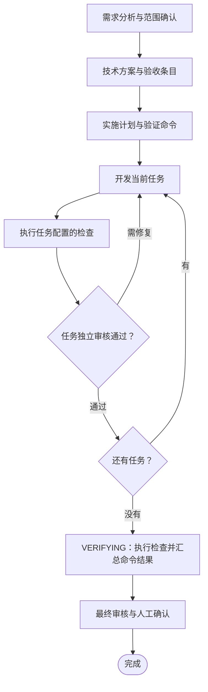
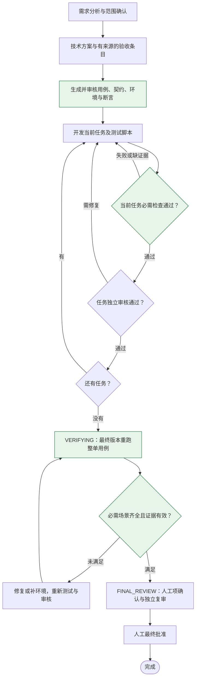

# 需求验收：流程变化、覆盖范围与实测方式

本次增加的是需求用例设计、浏览器执行和逐项验收证据校验。原有需求分析、技术方案、计划、任务独立审核和人工审批继续承担各自职责。业务项目仍需要根据自己的需求生成测试脚本；安装工作流不会自动得到所有页面的测试。

## 原来的流程

原流程已经有验收条目（AC）、验证命令、运行日志和独立审核。主要不足是命令成功与每个需求场景之间缺少可校验的直接关联：例如构建通过，不能据此判断“请求失败后点击重试能恢复”。



## 现在的流程

新增内容集中在开发前的用例设计、任务交审前的必需检查、最终候选的整单重跑，以及审核时的逐用例证据核对。图中合并展示原有 spec/plan 审核；没有增加一个独立的人工审批阶段。



整单检查按已审核计划分别运行契约模拟和必需的真实联调。必需联调未就绪时允许先记录模拟结果，但不能把整单标为通过。修复留在当前阶段处理，不通过回退状态跳过审核；自动修复达到配置上限后交由人处理。

## 当前覆盖了哪些场景

需要区分“工作流能够承载的场景”和“本次已经实际跑过的场景”。前者取决于具体项目补齐的用例、环境和脚本；后者有本次执行记录。

| 层次 | 本次实际验证 | 结论边界 |
| --- | --- | --- |
| 浏览器正常交互 | 正常加载、加载中状态、成功数据展示 | 在本地演示页面实测，不代表任意业务页面已覆盖 |
| 接口异常与恢复 | HTTP 500/503、HTTP 200 业务错误、网络中断、应用请求超时；错误提示、重试、恢复后新数据及错误清除 | 异常通过测试侧受控注入，运行真实前端逻辑 |
| 重复操作 | 加载中重复点击、重试中重复点击及混合点击，检查实际请求次数 | 验证当前页面防重，不等于后端幂等或高并发验证 |
| 后端未部署 | 实际服务不可用时，按演示契约直接替换响应完成前端验收 | 能证明契约假设下的前端行为，不能证明真实后端正确 |
| 无模拟的联调 | 浏览器调用独立本地 HTTP 服务，检查服务标识、返回契约与页面数据 | 验证了联调机制，尚未访问真实业务测试环境 |
| 证据与放行 | 用例漏跑、零退出无报告、skip/flaky、环境错配、模拟未命中、旧成功覆盖新失败、源码或证据变化、任务/整单隔离、人工确认及中断恢复 | 验证工作流不能仅凭一个退出码或过期报告放行 |

本次工作流全量测试为 **154/154 通过**。真实浏览器样例有 **9 个受控场景和 1 个本地联调场景**，经过正向、缺陷及恢复运行共执行 **15 次浏览器检查**；故意注入的 **9 个缺陷均在预定业务断言上失败**。这三个数量分别表示协议回归数量、样例场景数量和运行次数，不能相加作为业务覆盖率。[验证记录](verification/2026-11-15-acceptance-testing.md)

## 尚未覆盖和不能单靠它证明的内容

| 场景 | 当前边界 | 在真实项目中如何补齐 |
| --- | --- | --- |
| 需求本身写错、遗漏或存在歧义 | 工具无法自行知道产品真正想要什么，也不能承诺生成用例 100% 准确 | 查原文、确认规则、独立列举行为后对照用例，保留未决项 |
| 实际账号、登录、权限、跨页面业务链路 | 本次样例未验证这些业务 | 准备测试账号和数据，添加项目专属浏览器用例 |
| 空数据、边界值、部分接口失败等 | Skill 会提示检查适用性；样例没有覆盖所有维度 | 依据已确认规则生成对应场景，不能把提示列表当成执行结果 |
| 后端持久化、事务、幂等、消息/支付等外部结果 | 模拟响应不能证明服务端处理；UI 提示成功也不能证明数据真正入库 | 真实联调并检查授权可读的服务端结果，必要时增加后端测试 |
| 真实手机、WebView、小程序、原生桥、Service Worker 调用链 | 当前首个结果适配器读取 Playwright JSON；本次仅执行 Chromium 桌面环境 | 接入合适设备/工具，或定义并记录真实人工检查 |
| 浏览器兼容、视觉还原、动画、可访问性 | 当前样例没有对应专项断言；截图附件不等于视觉比对通过 | 补多浏览器、视觉或可访问性检查和相应验收标准 |
| 性能、压力、长时稳定性、安全专项 | 普通功能用例和单页防重不能代替这些专项 | 增加专项工具、指标与独立结果 |
| 人为伪造证据 | 指纹可发现记录后的改动，但本地报告与观察附件不是防恶意伪造的远程证明 | 审核测试代码及环境；有更强需求时使用可信执行环境 |

## 用例生成 Skill 如何实现

入口是 [acceptance-testing/SKILL.md](../.agents/skills/acceptance-testing/SKILL.md)，配合 [case-design.md](../.agents/skills/acceptance-testing/references/case-design.md) 和 [execution.md](../.agents/skills/acceptance-testing/references/execution.md)。它是一组给 Agent 执行的规范与参考资料，没有另做一个独立模型服务或固定模板式的用例生成器。

1. **读输入**：原始 PRD、确认记录、接口契约、当前 intake/delivery、项目测试约定。代码用于定位页面、请求和测试入口，不能反过来决定产品应有行为。
2. **先写验收标准**：在 spec 阶段写“给定什么条件、做什么操作、应出现什么结果”，并关联已确认来源。
3. **再设计用例**：在 plan 阶段补前置条件、操作、预期结果、可观察断言、环境、数据、执行检查与任务/整单归属，写进 delivery v2。不确定的契约或业务规则保留待确认。
4. **独立审核**：reviewer 先从原文列出应有行为，再对照生成用例，检查漏项、错误预期和只检查表面现象的问题。复用现有 spec/plan 审核，不让生成者自己宣称独立通过。
5. **写可执行脚本**：Agent 在业务项目中补测试、配置和 fixture。首个浏览器适配器使用完整 Playwright JSON；构建、lint、单测继续作为工程检查。
6. **验证用例有效性**：执行真实页面操作，核对原始结果；关键场景可在隔离副本注入一个明确缺陷，观察对应断言是否失败。当前样例实现了 9 个此类反例，尚未提供自动为任意项目生成全部缺陷的通用引擎。

例如需求说“加载失败后可重试”，用例应验证：触发明确失败 → 出现错误及重试入口 → 点击重试 → 实际发出新请求 → 展示新响应 → 清除错误状态。只检查“页面有重试按钮”不足以验收这条需求。

脚本负责硬校验：FR/AC/TC/check 关联完整，实际运行包含必需用例，文件/浏览器项目/环境匹配，模拟规则实际命中，证据属于当前版本。**业务预期是否正确，仍依赖来源、独立审核和实际验证，结构合法不代表语义正确。**

## 本次改动点

| 改动 | 作用 |
| --- | --- |
| 新增 acceptance-testing Skill，并接入 prd-to-code、prepare-review、review-delivery | 开发前设计用例，审核时逐项对照原文与证据 |
| delivery v2：testCases、environments、checks、verifyIds、finalCheckIds | 把需求、用例、环境和执行入口连接起来 |
| 新增用例定义校验、Playwright 结果读取、验收就绪判断 | 读取逐用例实际结果，区分工程检查、模拟验收、真实联调和人工项 |
| 改造验证执行器与任务/最终门禁 | 任务交审前必需检查通过，整单在最终候选上重跑，缺证据不能放行 |
| 加固快照、证据指纹、最新尝试选择和审核映射 | 防止旧结果、无关通过或错误环境被用来支撑当前验收 |
| 修复任务生命周期、计数和中断恢复 | 修复后必须重审；自动修复次数持久化；中断后可恢复已落盘结果 |
| 增加 v1 升级草案、说明、回归测试与真实浏览器演示 | 旧命令保留为工程检查，未知业务用例不会在迁移时被编造成通过 |

## 在真实需求里使用

在目标前端项目根目录安装当前分支的版本；升级已有安装时 `--force` 会先备份被替换文件：

```sh
npx --yes github:user-name919/frontend-workflow#feat-20260921-zkp setup . --force
```

仍从 `prd-to-code` 发起真实需求。可以附上：

> 按当前工作流开发这份需求。开发前使用 acceptance-testing 生成并审核需求用例；区分契约模拟与真实联调。后端未完成的接口先记录契约缺口；契约确认后测试前端行为，必需联调未完成时保留未验收状态。

Agent 需要实际项目的启动命令、可用账号、数据准备方式和确认契约，才能落实测试配置和脚本。工作流安装不会向业务项目强制安装 Playwright；测试运行时需要根据项目情况选择兼容版本。

进行中的 delivery v1 需求需显式升级为 v2，并重新审核受影响内容；历史 COMPLETE 需求不会自动重开。具体字段和命令见 [接入说明](../template/.ai-dev/acceptance-testing.md)。
