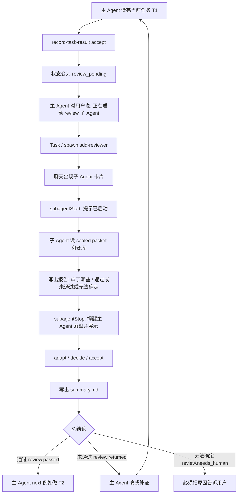
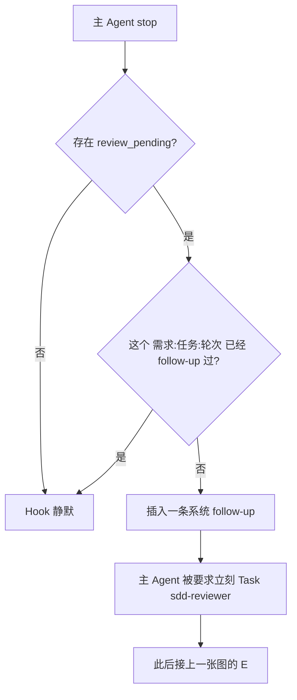
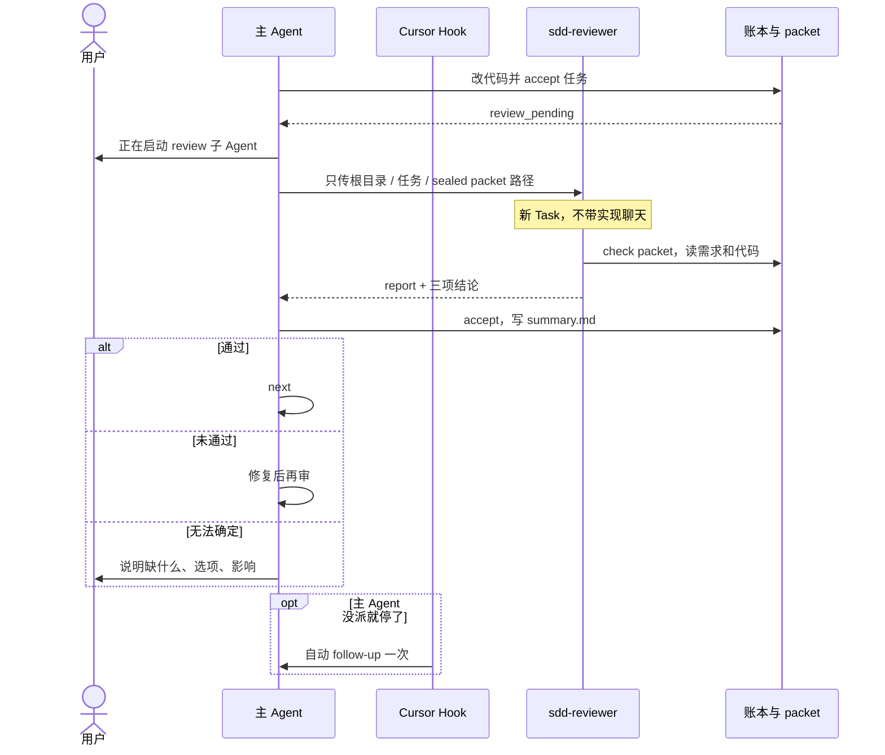

# 子 Agent 审核：感知、时机、空上下文、材料够不够

本文按**当前仓库实现**写，不按「理想上应该怎样」。结论先看表，细节和流程在后面。

## 一句话

用户**有机会**感知到 review 子 Agent，但**不能 100% 保证**每次都会出现卡片。  
触发时机是「当前任务已经 `review_pending`」，不是每次改文件。  
「空上下文」靠宿主新开 Task/spawn + 禁止粘贴实现聊天，**不是**密码学隔离。  
「材料够不够」靠主 Agent 必须交出 **sealed packet + 路径**，子 Agent 自己读需求和代码，不信主 Agent 口述。

---

## 1. 现在用户能不能感知到？

| 信号 | 会不会出现 | 硬不硬 |
| --- | --- | --- |
| 主对话先说「正在启动 review 子 Agent」 | Skill / Rule **要求**主 Agent 先说 | 软：主 Agent 可能不说 |
| 聊天里的 **Task / 子 Agent 卡片**（可点进去看过程） | 仅当主 Agent **真的**调了 Task `sdd-reviewer`（Codex 则是 spawn） | 软：主 Agent 可能本对话自审，没有卡片 |
| Hook 插入的 follow-up（像系统又提了一句） | 主 Agent **停下来还没派**，且任务是 `review_pending` | 半硬：每个 `需求:任务:轮次` **只插一次** |
| 子 Agent 启动时的 `user_message` | Task 类型匹配 `sdd-reviewer` 时 | 半硬：有卡片才会有这条 |
| 主对话里的审核表（审了哪些 / 通过 / 未通过 / 无法确定） | `accept` 后写 `summary.md`，Skill 要求展示 | 落盘是硬的；展示给人是软的 |

**所以：**

- 业务仓库要先 `setup`，才会有 `.cursor/agents/sdd-reviewer.md` 和 `.cursor/hooks/`。
- 用户**真看见卡片** = 主 Agent 发起了 Task/spawn。Hook 只能「再推主 Agent 一把」，不能代替点 Task。
- 如果只看到主 Agent 继续说话、没有子 Agent 卡片，就是唤起失败，独立性也不可信。

Codex：CLI 用 `/agent` 切线程；IDE 看 composer 上方的 background-agent。不能 spawn 时，新开会话跑 `$review-delivery` 也算独立审，但**不一定**出现在当前会话面板里。

---

## 2. 触发子 Agent 的时机是什么？

只认这一个业务时刻，**不是**每改一个文件就审：

> 主 Agent 已经把**当前任务**落成 `DONE` → 状态变成 `review_pending`。

| 顺序 | 谁 | 做什么 |
| --- | --- | --- |
| 1 | 主 Agent | 做完 T1，`record-task-result accept` → `review_pending` |
| 2 | 主 Agent（主路径） | **立刻**宣告 + Task/spawn `sdd-reviewer`，**不等用户打字** |
| 3 | Cursor `stop` hook | 若第 2 步没做主 Agent 就停了 → 自动插入一条 follow-up（每键一次） |
| 4 | 子 Agent | 审完交报告 |
| 5 | 主 Agent | `adapt` / `decide` / `accept`，写出 `summary.md` |
| 6a | 通过 | 抛 `review.passed`，主 Agent `next`（例如做 T2） |
| 6b | 未通过 | 抛 `review.returned`，主 Agent 改/补证，再自动审 |
| 6c | 无法确定 | 抛 `review.needs_human`，**必须把原因告诉用户** |

不会触发（故意不做）：

- 每次 `afterFileEdit`（不能 spawn，只会吵）
- 等人打 `/reviewer`（备用，不是主路径）
- Node 自己弹出卡片（Node 没有 Task 工具）

工作流硬门：T1 没独立 `pass` 之前，`next` **不会**派 T2。这保证「没审完不能往下做」，不保证「卡片一定出现」。

---

## 3. 怎么保证子 Agent 的上下文是空的？

**保证不了「绝对空」。** 只能保证「新开一条线程，并且不把实现聊天喂过去」。

当前约定：

| 手段 | 作用 | 限度 |
| --- | --- | --- |
| Cursor **新 Task**（`sdd-reviewer`） | 新上下文窗口，不是主对话续写 | 若主 Agent 把调试过程贴进 prompt，窗口就脏了 |
| Codex `spawn` 且 **`fork_context=false`** | 不复制父线程历史 | 部分版本选不到自定义 agent，会开成通用子线程 |
| Skill：**禁止**粘贴实现调试、禁止本对话改称 reviewer | 减少污染 | 靠主 Agent 遵守 |
| `self_check` / 同一 `hostRunId` 不能当独立通过 | 账本拒绝假独立 | 管不了「没派卡片却口头说审过」 |
| 新 Codex 会话 + `$review-delivery` | 人眼可见的另一条会话 | 不在当前聊天里出卡片 |

子 Agent 被要求：**不信主 Agent 口述**，只信 sealed packet、已确认需求和仓库里的文件。

若主 Agent 在本对话自审：上下文一定不空，也不算独立。Hook 的 follow-up 就是为了减少这种情况。

---

## 4. 怎么保证主 Agent 给的内容够子 Agent 把审核做对？

分两层：**最低材料（有校验）** 和 **主 Agent 必须塞进 Task prompt 的东西（约定）**。

### 4.1 最低材料（缺了审不了 / check 会失败）

主 Agent 在派子 Agent **之前**要准备好，并只把**路径**交给子 Agent：

| 材料 | 作用 |
| --- | --- |
| 项目根目录 `status.json.project.root` | 子 Agent 自己读真实代码 |
| 需求目录 `.ai-dev/features/<id>` | 状态、产物 |
| **sealed packet** 绝对路径 | `prepare-review` 从**已确认**需求制包并 `seal`；过期/缺文件 `check` 失败，子 Agent 必须退回，不得改摘要凑过 |
| 当前任务 id（如 T1） | 只审这一包，不扫无关需求 |

子 Agent 启动后自己读：

- `.agents/skills/review-delivery/SKILL.md`
- `review-authority.md`
- packet 里的验收、来源、范围内文件
- 仓库里的实际 diff / 文件（不靠主 Agent 讲「我已经测过了」）

测试/验证：**测试型通过必须有真实跑过的记录**（命令、退出码、输出在包里）。主 Agent 没跑、只在聊天里说测过，子 Agent 不能记成通过，应 `needs_evidence` 退回主 Agent 补证。

### 4.2 Task prompt 最低字段（主 Agent 少一项就不该派）

```text
项目根目录：
需求目录：
任务：T1
sealed packet：<绝对路径>
只审该任务已确认 FR/AC。
产出：审核了哪些、通过/未通过/无法确定及原因。
不要改业务代码。
不要粘贴实现过程。
```

### 4.3 什么叫「不够」，系统怎么挡

| 不够的情况 | 谁挡住 |
| --- | --- |
| packet 过期、漏文件、格式坏 | `review-contract check` 失败，停审 |
| 从实现反推需求 | Skill 禁止；独立审不能把代码当需求来源 |
| 主 Agent 只给一句话「帮我看看」没有 packet | 子 Agent 应拒绝，退回制包 |
| 同一实现者 runId 自称独立通过 | `SAME_IMPLEMENTER_RUN` / `self_check` 拒收 |
| 材料够但产品规则没写 | 结论必须是「无法确定」，告诉用户，不能放行 |

**不能保证的：** 主 Agent 若漏传 packet 仍强行 Task，或把错误路径塞进去——没有操作系统级拦截，只有子 Agent `check` 和账本校验。所以「正确性」= **制包质量 + check + 子 Agent 自己读仓库**，不是主 Agent 写一段摘要。

---

## 5. 当前流程图

### 5.1 主路径（用户应看到卡片）



### 5.2 主 Agent 停下来没派时（Hook 补一刀）



### 5.3 材料与空上下文



---

## 6. 和「保证」有关的实话

| 问题 | 现状 |
| --- | --- |
| 用户一定能看到子 Agent？ | **不能保证。** 看到卡片 = 主 Agent 真的 Task/spawn。Hook 只保证「没派就停时再催一次」。 |
| 时机是否清楚？ | **清楚。** 只有 `review_pending`，不是改文件、不是等人下令。 |
| 上下文是否一定空？ | **约定空，不是绝对空。** 新线程 + 禁粘贴；粘贴了就脏。 |
| 材料是否一定够、测试是否一定对？ | **packet check + 子 Agent 自读仓库** 是硬门槛；主 Agent 漏路径只能靠子 Agent 拒审。测试通过必须有真实执行记录。 |

业务项目需要重新 `setup` 后，`.cursor/hooks/` 和 `sdd-reviewer` 才会进你的前端仓库。本工作流仓库里的模板在 `template/.cursor/`。
