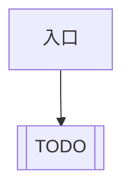
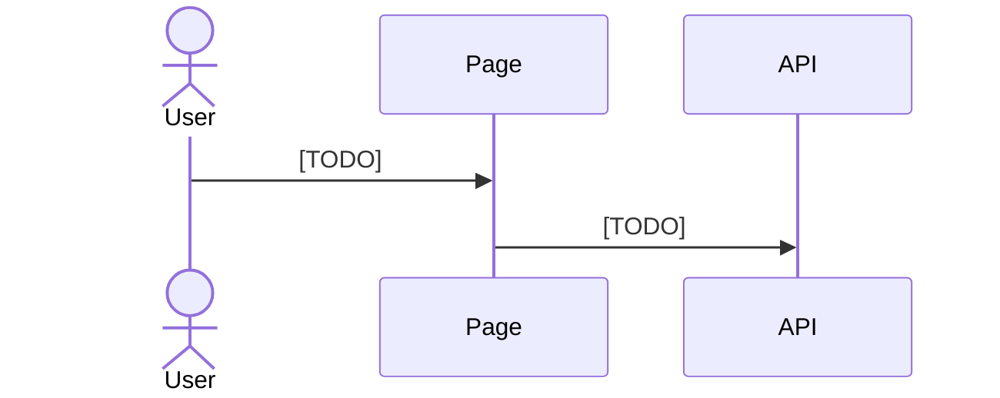

<!-- 副产物：给开发人员阅读。需求/验收 ID 以 intake.json、delivery.json 为准，不要在本文另起一套编号。 -->

# 技术方案

本文是结构化台账的阅读件，不是门禁账本。用 Mermaid 画清主路径和协作顺序；图中的状态名、接口名必须能在需求或契约里找到依据。

## 目标

[TODO] 用已确认需求说明这次前端要交付的可观察结果。

## 非目标

- [TODO] 后端、其他仓库、本次不做的交互

## 需求对照

引用 `intake.json` 的 FR-*，验收引用 `delivery.json` 的 AC-*。

### FR-1

- 行为：
- 验收：AC-1
- 空 / 失败 / 重复操作：

## 主流程

## 时序

## 状态与边界

不适用的场景写原因，不要为凑图增加功能。

- 成功：
- 加载：
- 空数据：
- 失败与恢复：
- 重复点击 / 连续异常：

## 兼容与约束

- 沿用的仓库约定：
- 明确不改的模块：
