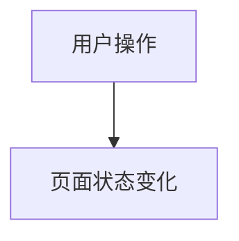

# 技术方案（技术评审使用）

## 背景与目标

[TODO] 用业务语言说明目标、范围和非目标；正文不要求 FR/AC 编号。

## 项目现状

[TODO] 根据真实项目说明相关页面、模块和已有能力。

## 整体方案

[TODO] 从编号版派生，解释改哪里、为什么，区分已有能力与本次变化。

## 架构图

## 流程图

## 关键实现与取舍

[TODO] 写明接口、数据流、复用方案及关键决策，必要时补时序图。

## 边界与风险

[TODO] 覆盖空数据、异常、恢复、重复操作、兼容与未决事项。

## 验证方式

[TODO] 说明验收与验证方法；不得新增编号版未确认的业务规则。
